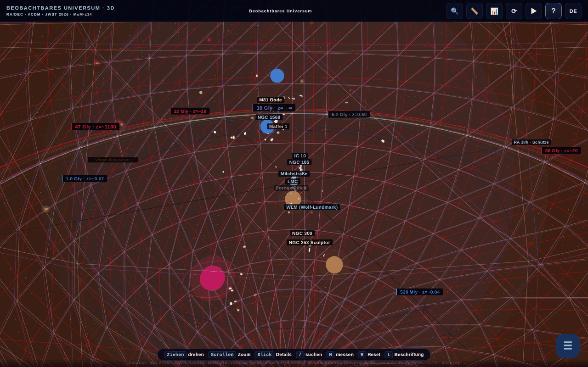

# Universul Observabil 3D

[English](README.md) · [Română](README.ro.md) · [Français](README.fr.md) · [Italiano](README.it.md) · [Español](README.es.md) · [Português](README.pt.md) · **Deutsch** · [Magyar](README.hu.md)

**Version:** 1.4.10 · **Zuletzt aktualisiert:** 2026-10-23

Oberflächensprachen: **Română, English, Français, Italiano, Español, Português (PT), Deutsch, Magyar**

**Online / Demo:** https://chiuta.github.io/Universul-Observabil-3D/

Interaktive 3D-Karte des beobachtbaren Universums, in einer einzigen HTML-Datei (WebGL / three.js): über 115 Galaxien (118 im statischen Katalog), 12 kosmische Horizonte, Zeitregler, geführte Touren, Suche, Entfernungsmessung, Quiz, glTF/CSV-Export und BibTeX. Oberfläche in 8 Sprachen.

**Sprachen:** die vollständige Anleitung (11 Reiter), die 30 geführten Touren (rund 200 Schritte), die 17 „Wusstest du schon?“, das Onboarding, die Beschreibungen der 118 Galaxien und der 13 Horizonte/BAO, die Namen Dutzender Objekte, das Fenster zum 45,6-Gly-Paradoxon und das Kontextglossar (10 Begriffe) liegen in den 8 Sprachen vor. Unverändert bleiben: Eigennamen (z. B. M81 Bode, Maffei), das zweisprachige Etikett „Limbă / Language“, generierte Inhalte und CSV-Importe. Die Übersetzungen sind automatisch; eine muttersprachliche Prüfung wird empfohlen (besonders HU/PT/DE). Die rumänische Quelle enthält einige fragwürdige Aussagen, die getreu und ohne inhaltliche Änderung übersetzt wurden.

- `index.html` — die interaktive 3D-Anwendung;
- `catalog.html` — statische Version des Katalogs ohne JavaScript (Barrierefreiheit und SEO). In dieser Sprache: [`catalog.de.html`](catalog.de.html).

## Zu den Daten
Positionen, Entfernungen und Massen sind **näherungsweise und vereinfachte** Werte, berechnet im ΛCDM-Rahmen (Planck 2018) und zusammengestellt aus öffentlichen Katalogen (NED, SIMBAD, die JWST-Programme CEERS/JADES/UNCOVER). Die Skala ist logarithmisch und dient der Veranschaulichung/Bildung; sie ersetzt nicht die Originalkataloge. „Verderbliche“ Aussagen (z. B. „die am weitesten entfernte bekannte Galaxie“, MoM-z14, z=14,44; Katalog „aktualisiert im Mai 2026“) können veralten. Die kosmologischen Werte (einschließlich der Hubble-Konstante) haben Unsicherheiten und offene Spannungen. Die genaue Liste der Quellen je Galaxie ist nicht in der Anwendung enthalten.

### „Rekord“-Aussagen und Daten
Aussagen vom Typ „die am weitesten entfernte Galaxie“ sind **zum Stand des Katalogs (Mai 2026)** formuliert und können durch spätere Beobachtungen überholt werden. Erneut geprüft am 11.10.2026: In den eingesehenen öffentlichen Quellen (STScI/NASA, Wikipedia, Presse) bleibt MoM-z14 die am weitesten entfernte spektroskopisch bestätigte Galaxie; ein neuer Rekord wurde nicht gefunden. Quellen: MoM-z14 (z_spec = 14,44) — Naidu et al., arXiv:2505.11263 (Preprint Mai 2025, veröffentlicht im Open Journal of Astrophysics, Januar 2026); JADES-GS-z14-0 — Carniani et al. 2024, Nature; EGS-z11-R0 — arXiv:2603.15841 (Eintrag vom März 2026, vom Autor nicht unabhängig geprüft; der spektroskopische Status wurde hier nicht bestätigt). Die Labels „NEU“/„REKORD“ in den Namen wurden durch explizite Daten ersetzt („hinzugefügt März 2026“, „Rekord (Mai 2026)“). Die Quellen je Galaxie sind nicht vollständig aufgeführt; die Bibliografie wird noch vervollständigt.

## Verwendung
Öffnen Sie `index.html` in einem Browser mit WebGL. Die Taste `R` setzt die Kamera zurück, `/` sucht, `?` öffnet die Anleitung und die Tour.

## Daten und Datenschutz
Per Audit geprüft: keine Netzwerkanfragen beim Laden. Die Schriftarten sind enthalten; die gewählte Sprache und die Lesezeichen werden in `localStorage` gespeichert. Links zu arXiv/externen Seiten öffnen sich nur beim Klicken. Es gibt Code (deaktiviert, die Liste `MIRROR_URLS` ist leer) zum Versionsvergleich zwischen Spiegeln, der nur dann ein `fetch` ausführen würde, wenn er konfiguriert ist. Die CSP in `index.html` beschränkt `connect-src` jetzt auf `'self'` (da die Liste `MIRROR_URLS` leer ist, kann der Spiegel-Code keine externen Anfragen stellen; wenn Sie ihn konfigurieren, erweitern Sie `connect-src` um die Hosts der Spiegel). Inline-Skripte sind nur über einen `sha256`-Hash in `script-src` erlaubt: **Berechnen Sie nach jeder Änderung eines Skripts die Hashes neu** im CSP-Meta, sonst läuft das geänderte Skript nicht.

## Einschränkungen
- Unter iOS sind Pinch-Gesten, die **auf dem Canvas** beginnen, der 3D-Kamera vorbehalten; auf Panels und Texten bleibt der systemeigene Zoom verfügbar (Runde 3).
- Die BibTeX-Zitate der Anwendung (Schaltfläche „Diese Anwendung zitieren“ und `catalog.html`) haben kein DOI-Feld: Die Anwendung hat noch keine Zenodo-DOI; das falsche Feld wurde entfernt (Runde 2).

## Lizenz
MIT, gemäß dem Kopf der Dateien; siehe `LICENSE`. Die Seite trägt auch Erwähnungen von ASFAN-România.

## Rechte und Namensnennung
Die Anwendung und der Code gehören dem Autor (MIT-Lizenz, siehe `LICENSE`). Die astronomischen Daten stammen aus öffentlichen Veröffentlichungen und Katalogen (NED, SIMBAD, arXiv, Planck 2018); die Rechte an Materialien Dritter gehören ihren Inhabern, und die MIT-Lizenz deckt sie nicht ab. Wenn Sie Rechteinhaber oder eine erwähnte Person sind und eine Berichtigung oder Rücknahme wünschen, schreiben Sie an alexio@trom.tf; wir antworten innerhalb von 7 Tagen.

Audit: 2026-10-10; Runde 2: 2026-10-11 (Platzhalter-DOI aus den Zitaten entfernt, `connect-src 'self'`).
Runde 3: 2026-10-11 (Formulierungen „zum Stand des Katalogs“, Quellen für Rekorde, iOS-Gesten auf den Canvas beschränkt).

## Am 11.10.2026 geprüfte Quellen
- Der Entfernungsrekord MoM-z14: https://www.stsci.edu/contents/news-releases/2026/news-2026-107 (Mitteilung vom 28. Januar 2026), https://en.wikipedia.org/wiki/MoM-z14 und https://en.wikipedia.org/wiki/List_of_the_most_distant_astronomical_objects — kein weiter entfernter spektroskopischer Rekord gefunden. Die Katalogdaten bleiben die vom Mai 2026 (EGS-z11-R0 bleibt unabhängig ungeprüft).

## Verlauf / Changelog

### 1.4.10 — 2026-10-23
- fff-kit 1.2.0: Alle Browser-Schlüssel (Sprache, Lesezeichen, Leistungswahl, Einführung, sanfter Start) tragen jetzt das Präfix `universul-observabil-3d.`; die alten (`up3_lang`, `univers_obs_bk`, `up3-perf-*`, `up3-onboarded-v2`, `up3-gentle-start`) werden beim Start automatisch migriert, sodass vorhandene Lesezeichen und Einstellungen erhalten bleiben, auch nach dem Import einer alten .fff.json-Sicherung. Die Ausweichlösung „Link kopieren“ nutzt nicht mehr das native Browser-Fenster, sondern einen barrierefreien Dialog.

### 1.4.8 — 2026-10-22
- fff-kit 1.1.4: Touch-Ziele und Mindestschriftgröße; Touch-Ziele/Text korrigiert

### 1.4.7 — 2026-10-22
- fff-kit 1.1.2: PBKDF2 mit 600.000 Iterationen, Schutz vor Clickjacking.

### 1.4.6 — 2026-10-22
- Wirklich offline: Das eingebettete Manifest (data:-URL) wurde durch einen echten sw.js (Cache zuerst mit Hintergrund-Revalidierung), eine Web-Manifest-Datei und Symbole ersetzt; die App öffnet sich nun nach dem ersten Besuch ohne Netz und kann installiert werden.
- Barrierefreiheit: Die Seite hat jetzt genau eine H1 (die Titelleiste); das CSV-Importfeld und der Skalenfaktor-Regler haben Namen, die Screenreader ansagen (8 Sprachen); die Regler für Zeit und Entfernungsfilter haben 24-px-Touch-Flächen.
- Mobil: Der Oberflächentext ist mindestens 12 px groß, und die Schaltflächen für Orientierungspunkte haben größere Touch-Flächen.

- **1.4.5 — 2026-10-22:** die Abkürzung „Einh.“ in der Anzeige der Eigenentfernung des Widgets für das mitbewegte Gitter folgt jetzt der Oberflächensprache.
- **1.4.4 — 2026-10-22:** alle Schaltflächenbeschriftungen der Einführung und die Markierungen des Entfernungsreglers („Kamera zurücksetzen“, „Flug zur Andromeda-Galaxie“, „Zum CMB“ …) sind in allen 8 Sprachen übersetzt.
- **1.4.3 — 2026-10-22:** Seitentitel und Meta-Beschreibungen folgen der Oberflächensprache; der Hinweis „R reset“ ist auf Rumänisch lokalisiert („resetare“).
- **1.4.2 — 2026-10-19:** 20 Objektnamen in den 3D-Beschriftungen, im Panel und in der Suche übersetzt; Fenster zum 45,6-Gly-Paradoxon vollständig übersetzt; das Kontextglossar funktioniert jetzt in allen Sprachen (10 Begriffe × 7 Sprachen, bei Sprachwechsel neu angewendet); korrigiert: „💡 WUSSTEST DU SCHON“ war in fr noch rumänisch, ebenso das aria-label des Canvas und die Schaltfläche „‹ Zurück“.
- **1.4.1 — 2026-10-19:** die vollständige Anleitung (11 Reiter), die 30 Touren, die „Wusstest du schon?“, das Onboarding und die Galaxien-/Horizontbeschreibungen sind nach en, fr, it, es, pt, de, hu übersetzt; Anleitung/Tour werden beim Sprachwechsel neu angezeigt.
- 1.3.0 — 2026-10-14: Sicherungskopie und Datenkennzeichnung (fff-kit).
- **1.2.4 — 12. Oktober 2026:** Die Version und das Datum der letzten Aktualisierung werden in der Anwendung angezeigt (Dialog Anleitung).
- **1.2.3 — 11. Oktober 2026:** Die Taste `/` (oder Strg/Cmd+K) setzt den Fokus sofort in das Suchfeld, sodass Eingaben auch bei langsamem 3D-Rendering nicht mehr verloren gehen; auf schmalen Bildschirmen (≤700 px) öffnet sich die Willkommensanleitung nicht mehr automatisch über der Szene, stattdessen pulsiert die Schaltfläche „?“, bis Sie sie berühren; 0 Fehler, axe 0 Verstöße bei 1280×800 und 360×740.
- **1.2.2 — 11. Oktober 2026:** CSP mit `sha256`-Hash für die vier Inline-Skripte (ohne `'unsafe-inline'` und ohne `blob:` in `script-src`); Link „Barrierefreier Textkatalog (ohne JavaScript)“ zu `catalog.html`, erstes fokussierbares Element der Seite (bei Fokus sichtbar, RO/EN) und in der `noscript`-Meldung, als Textalternative zur WebGL-Szene für Screenreader und Tastatur; Version 1.2.2 (Anwendung, `catalog.html`, BibTeX-Zitat).
- **1.2.1 — 11. Oktober 2026:** Im Suchfeld funktionieren jetzt ↑/↓/Eingabe/Esc (vorher ignorierte der globale Handler Ereignisse aus INPUT); überlappende 3D-Labels werden automatisch nach Priorität ausgeblendet (Horizonte, dann Galaxien in Entfernungsreihenfolge), statt sich zu vermischen; die Willkommenstour wird beim ersten Öffnen als gesehen markiert und öffnet sich daher nicht bei jedem Laden erneut, wenn sie mit ✕/Esc geschlossen wurde.
- Barrierefreiheit/Aufräumen: Landmarken `main` / `complementary` (axe-core: 0 Verstöße bei 1280×800 und 360×740), `catalog.html`: Tabellen scrollen auf schmalen Bildschirmen horizontal (kein Überlaufen der Seite bei 360 px); Inline-Handler `onclick` entfernt (die Schaltfläche „CSV exportieren“ in der Zitattabelle), Build-Datum 2026-10-11 in der Anwendung, `catalog.html` und Metas, Versionsnummer überall aktualisiert.
