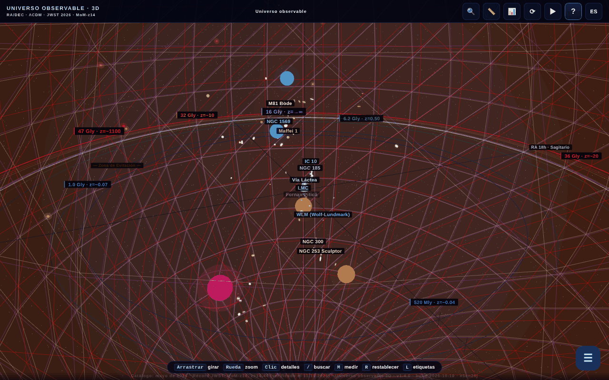

# Universul Observabil 3D

[English](README.md) · [Română](README.ro.md) · [Français](README.fr.md) · [Italiano](README.it.md) · **Español** · [Português](README.pt.md) · [Deutsch](README.de.md) · [Magyar](README.hu.md)

**Versión:** 2.1.1 · **Última actualización:** 2026-10-28

**Estado:** estable · **Sin conexión:** completo

Idiomas de la interfaz: **Română, English, Français, Italiano, Español, Português (PT), Deutsch, Magyar**

**En línea / demo:** https://chiuta.github.io/Universul-Observabil-3D/

Mapa 3D interactivo del universo observable, en un solo archivo HTML (WebGL / three.js): más de 115 galaxias (118 en el catálogo estático), 12 horizontes cósmicos, control deslizante de tiempo, visitas guiadas, búsqueda, medición de distancias, cuestionario, exportación glTF/CSV y BibTeX. Interfaz en 8 idiomas.

**Idiomas:** la guía completa (11 pestañas), las 30 visitas guiadas (unos 200 pasos), los 17 «¿Sabías que?», la incorporación, las descripciones de las 118 galaxias y de los 13 horizontes/BAO, los nombres de decenas de objetos, la ventana de la paradoja de 45,6 Gal y el glosario contextual (10 términos) están disponibles en los 8 idiomas. Permanecen sin cambios: los nombres propios (p. ej. M81 Bode, Maffei), la etiqueta bilingüe «Limbă / Language», el contenido generado y las importaciones CSV. Las traducciones son automáticas; se recomienda revisión nativa (sobre todo HU/PT/DE). La fuente rumana contiene algunas afirmaciones discutibles, traducidas fielmente sin cambios de fondo.

- `index.html` — la aplicación 3D interactiva;
- `catalog.html` — versión estática, sin JavaScript, del catálogo (accesibilidad y SEO). En este idioma: [`catalog.es.html`](catalog.es.html).

## Sobre los datos
Las posiciones, distancias y masas son valores **aproximados y simplificados**, calculados en el marco ΛCDM (Planck 2018) y reunidos a partir de catálogos públicos (NED, SIMBAD, los programas JWST CEERS/JADES/UNCOVER). La escala es logarítmica y tiene fines ilustrativos/educativos; no sustituye a los catálogos originales. Las afirmaciones «perecederas» (p. ej. «la galaxia conocida más lejana», MoM-z14, z=14,44; catálogo «actualizado en mayo de 2026») pueden quedar obsoletas. Los valores cosmológicos (incluida la constante de Hubble) tienen incertidumbres y tensiones abiertas. La lista exacta de fuentes por galaxia no está incluida en la aplicación.

### Afirmaciones de «récord» y fechas
Las afirmaciones del tipo «la galaxia más lejana» están formuladas **a la fecha del catálogo (mayo de 2026)** y pueden ser superadas por observaciones posteriores. Reverificado el 11.10.2026: en las fuentes públicas consultadas (STScI/NASA, Wikipedia, prensa) MoM-z14 sigue siendo la galaxia más lejana confirmada espectroscópicamente; no se encontró ningún récord nuevo. Fuentes: MoM-z14 (z_spec = 14,44) — Naidu et al., arXiv:2505.11263 (preprint de mayo de 2025, publicado en el Open Journal of Astrophysics, enero de 2026); JADES-GS-z14-0 — Carniani et al. 2024, Nature; EGS-z11-R0 — arXiv:2603.15841 (entrada de marzo de 2026, no verificada de forma independiente por el autor; el estado espectroscópico no se confirmó aquí). Las etiquetas «NUEVO»/«RÉCORD» de los nombres se sustituyeron por fechas explícitas («añadida mar. 2026», «récord (may. 2026)»). Las fuentes por galaxia no se enumeran íntegramente; la bibliografía está en proceso de completarse.

## Uso
Abre `index.html` en un navegador con WebGL. La tecla `R` restablece la cámara, `/` busca, `?` abre la guía y la visita.

## Datos y privacidad
Verificado mediante auditoría: sin solicitudes de red al cargar. Las fuentes tipográficas están incluidas; el idioma elegido y los marcadores se guardan en `localStorage`. Los enlaces a arXiv/sitios externos solo se abren al hacer clic. Existe código (desactivado, la lista `MIRROR_URLS` está vacía) para comparar versiones entre espejos, que haría un `fetch` solo si se configurara. La CSP de `index.html` limita ahora `connect-src` a `'self'` (al estar vacía la lista `MIRROR_URLS`, el código de espejos no puede hacer solicitudes externas; si la configuras, amplía `connect-src` con los hosts de los espejos). Los scripts en línea solo se permiten mediante un hash `sha256` en `script-src`: **tras cualquier modificación de un script, recalcula los hashes** en el meta CSP, de lo contrario el script modificado no se ejecuta.

## Limitaciones
- En iOS, los gestos de pellizco iniciados **sobre el lienzo** están reservados a la cámara 3D; en paneles y textos, el zoom nativo del sistema sigue disponible (ronda 3).
- Las citas BibTeX de la aplicación (botón «Citar esta aplicación» y `catalog.html`) no tienen campo DOI: la aplicación aún no tiene un DOI de Zenodo; el campo falso se eliminó (ronda 2).

## Licencia
MIT, según la cabecera de los archivos; véase `LICENSE`. La página también lleva menciones de ASFAN-România.

## Derechos y atribución
La aplicación y el código pertenecen al autor (licencia MIT, véase `LICENSE`). Los datos astronómicos proceden de publicaciones y catálogos públicos (NED, SIMBAD, arXiv, Planck 2018); los derechos sobre materiales de terceros pertenecen a sus titulares, y la licencia MIT no los cubre. Si eres titular de derechos o una persona mencionada y deseas la corrección o la retirada, escribe a alexio@trom.tf; respondemos en 7 días.

Auditoría: 2026-10-10; ronda 2: 2026-10-11 (eliminado el DOI de relleno de las citas, `connect-src 'self'`).
Ronda 3: 2026-10-11 (formulaciones «a la fecha del catálogo», fuentes para los récords, gestos iOS limitados al lienzo).

## Fuentes verificadas el 11.10.2026
- El récord de distancia MoM-z14: https://www.stsci.edu/contents/news-releases/2026/news-2026-107 (comunicado del 28 de enero de 2026), https://en.wikipedia.org/wiki/MoM-z14 y https://en.wikipedia.org/wiki/List_of_the_most_distant_astronomical_objects — no se encontró ningún récord espectroscópico más lejano. Los datos del catálogo siguen siendo los de mayo de 2026 (EGS-z11-R0 sigue sin verificarse de forma independiente).

## Tamaño de los catálogos en la serie (2.0.1)

- **Cifras.** Hub: 112 entradas (copia idéntica del catálogo 1D). 1D: 112. 2D: 112 (111 galaxias + el horizonte del CMB; algunos textos dicen 111). 3D: 118 («más de 115» en las descripciones). Las cifras difieren porque los catálogos son independientes, no por un error de recuento.
- **No unificados.** La 3D tiene su propio catálogo, con otra estructura (AR en horas, otros nombres y grafías), por lo que sus nombres solo coinciden en parte con 1D/2D. No se fusionaron en un único archivo común: cada aplicación es un archivo único sin conexión y sin paso de compilación común, y fusionar cambiaría los datos de tres aplicaciones sin forma de validarlos aquí. Señalado al autor.
- **Conflicto 1D ↔ 2D (resuelto el 2026-10-28; fuentes y fórmulas en `docs/DISCREPANTE.md` del hub).** Las 8 distancias (NGC 1132, IC 310, 3C 48, Abell 370, CL 0024+1654, SDSS J1004+4112, IC 4296, Abell 1689) siguen ahora una única convención en ambas aplicaciones: d = lb = lookback(z), en Mal, ΛCDM plano Planck 2018 (H₀ = 67,4, Ωm = 0,315), con z confirmado por al menos 2 fuentes; la 2D adoptó los valores de la 1D (330, 270, 4150, 4200, 4400, 10050, 180, 2330). El corrimiento al rojo de Andrómeda (M31) es −0,001 en ambas (M31 está desplazada hacia el azul, −301 km/s). La etiqueta «Perseus (BCG IC 310)» pasó a ser «IC 310 (Perseus)»: IC 310 no es la galaxia más brillante del cúmulo (esa es NGC 1275, entrada aparte).

## Récords JWST reverificados (27.10.2026)

- **MoM-z14:** z = 14,44, aún la galaxia más lejana confirmada espectroscópicamente (Naidu et al., arXiv:2505.11263; publicado en Open Journal of Astrophysics, ene. 2026).
- **JADES-GS-z14-0:** NIRSpec z = 14,32 (+0,08/−0,20) (Carniani et al. 2024, Nature); ALMA [OIII] 88 µm z = 14,1793 ± 0,0007 (Schouws et al. 2025, arXiv:2409.20549), compatible. El catálogo conserva el valor NIRSpec; el valor ALMA se indica en la descripción.
- **PAN-z14-1:** z = 13,53 (+0,05/−0,06), JWST/NIRSpec (Donnan et al., arXiv:2601.11515, ene. 2026): cuarta por distancia, no un récord. No se añadió al catálogo (coordenadas sin verificar), solo se menciona en la nota de MoM-z14.

## JWST note in 8 languages (2.1.0)

_(English only; not yet translated into this language. Machine translation intentionally not added to avoid errors in technical statements.)_

- The citation note for JADES-GS-z14-0 ("Record JWST: z=14.32 NIRSpec; ALMA [OIII]88µm z=14.1793 (Schouws+ 2025, arXiv:2409.20549)") is now translated through the existing UI dictionary (`UI_DICT`) into en/fr/it/es/pt/de/hu — a **machine translation** of the "Record JWST" part; the ALMA/arXiv part is language-neutral. Existing keys were not modified.
- The 3D catalogue (118 entries) stays separate; the 1D↔2D discrepancies are in the 1D/2D/hub repositories (`docs/DISCREPANTE.md`). Catalogue merging: not done.

## Historial / Changelog

### 2.1.1 — 2026-10-28
- Solo README: el conflicto 1D ↔ 2D está resuelto (véase `docs/DISCREPANTE.md` del hub); el catálogo 3D no cambió.

### 2.1.0 — 2026-10-27
- JWST note machine-translated.

### 1.4.11 — 2026-10-23
- Marcadores: los datos corruptos de `localStorage` (no es una lista, entradas nulas/no numéricas) ya no bloquean la aplicación — se ignoran; la versión mostrada en el pie/«Acerca de» y en la cita vuelve a ser la real.

### 1.4.10 — 2026-10-23
- fff-kit 1.2.0: todas las claves del navegador (idioma, marcadores, elección de rendimiento, introducción, inicio suave) llevan ahora el prefijo `universul-observabil-3d.`; las antiguas (`up3_lang`, `univers_obs_bk`, `up3-perf-*`, `up3-onboarded-v2`, `up3-gentle-start`) se migran automáticamente al iniciar, de modo que los marcadores y ajustes existentes se conservan, también tras importar una copia .fff.json antigua. La alternativa «copiar el enlace» ya no usa el cuadro nativo del navegador, sino un diálogo accesible.

### 1.4.8 — 2026-10-22
- fff-kit 1.1.4: objetivos táctiles y texto mínimo; objetivos táctiles/texto corregidos

### 1.4.7 — 2026-10-22
- fff-kit 1.1.2: PBKDF2 con 600.000 iteraciones, protección anti-clickjacking.

### 1.4.6 — 2026-10-22
- Sin conexión de verdad: el manifiesto incrustado (URL data:) se sustituyó por un sw.js real (caché primero con revalidación en segundo plano), un archivo de manifiesto web e iconos; la aplicación se abre ahora sin red tras la primera visita y se puede instalar.
- Accesibilidad: la página tiene ahora exactamente un H1 (la barra de título); el campo de importación CSV y el control del factor de escala tienen un nombre que anuncian los lectores de pantalla (8 idiomas); los controles de tiempo y de filtro de distancia tienen áreas táctiles de 24 px.
- Móvil: el texto de la interfaz mide al menos 12 px y los botones de puntos de referencia tienen áreas táctiles mayores.

- **1.4.5 — 2026-10-22:** la abreviatura «unidades» en la lectura de la distancia propia del widget de la cuadrícula comóvil sigue ahora el idioma de la interfaz.
- **1.4.4 — 2026-10-22:** todas las etiquetas de los botones de la guía de introducción y las referencias del control de distancia («Restablecer la cámara», «Volar hasta Andrómeda», «Hacia el CMB»…) están traducidas a los 8 idiomas.
- **1.4.3 — 2026-10-22:** el título de la página y las metadescripciones siguen el idioma de la interfaz; la indicación «R reset» está localizada en rumano («resetare»).
- **1.4.2 — 2026-10-19:** traducidos 20 nombres de objetos en las etiquetas 3D, el panel y la búsqueda; ventana de la paradoja de 45,6 Gal traducida por completo; el glosario contextual funciona ahora en todos los idiomas (10 términos × 7 idiomas, reaplicado al cambiar de idioma); corregido «💡 ¿SABÍAS QUE?» que seguía en rumano en fr, además del aria-label del canvas y el botón «‹ Atrás».
- **1.4.1 — 2026-10-19:** la guía completa (11 pestañas), las 30 visitas, los «¿Sabías que?», la incorporación y las descripciones de galaxias/horizontes están traducidos a en, fr, it, es, pt, de, hu; la guía/visita se vuelve a mostrar al cambiar de idioma.
- 1.3.0 — 2026-10-14: Copia de respaldo y etiquetado de datos (fff-kit).
- **1.2.4 — 12 de octubre de 2026:** la versión y la fecha de la última actualización se muestran en la aplicación (cuadro de diálogo Guía).
- **1.2.3 — 11 de octubre de 2026:** la tecla `/` (o Ctrl/Cmd+K) mueve el foco de inmediato al campo de búsqueda, por lo que lo que se escribe ya no se pierde ni cuando el renderizado 3D es lento; en pantallas estrechas (≤700 px) la guía de bienvenida ya no se abre automáticamente sobre la escena, sino que el botón «?» parpadea hasta que lo toques; 0 errores, axe 0 infracciones a 1280×800 y 360×740.
- **1.2.2 — 11 de octubre de 2026:** CSP con hash `sha256` para los cuatro scripts en línea (sin `'unsafe-inline'` ni `blob:` en `script-src`); enlace «Catálogo de texto accesible (sin JavaScript)» a `catalog.html`, primer elemento enfocable de la página (visible al recibir el foco, RO/EN) y en el mensaje `noscript`, como alternativa textual a la escena WebGL para lectores de pantalla y teclado; versión 1.2.2 (aplicación, `catalog.html`, cita BibTeX).
- **1.2.1 — 11 de octubre de 2026:** en el campo de búsqueda funcionan ahora ↑/↓/Intro/Esc (antes el manejador global ignoraba los eventos de INPUT); las etiquetas 3D que se solapan se ocultan automáticamente por prioridad (horizontes, luego galaxias por orden de distancia) en lugar de mezclarse; la visita de bienvenida se marca como vista en la primera apertura, por lo que ya no se reabre en cada carga si se cerró con ✕/Esc.
- Accesibilidad/limpieza: puntos de referencia `main` / `complementary` (axe-core: 0 infracciones a 1280×800 y 360×740), `catalog.html`: las tablas se desplazan horizontalmente en pantallas estrechas (sin desbordamiento de la página a 360 px); manejador `onclick` en línea eliminado (el botón «Exportar CSV» de la tabla de citas), fecha de compilación 2026-10-11 en la aplicación, `catalog.html` y metas, número de versión actualizado en todas partes.
