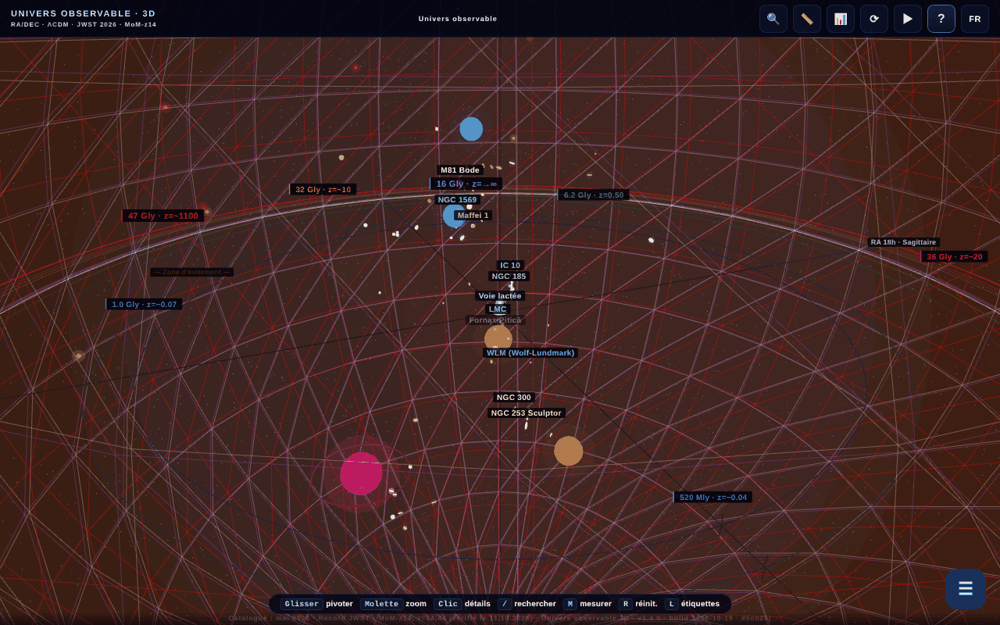

# Universul Observabil 3D

[English](README.md) · [Română](README.ro.md) · **Français** · [Italiano](README.it.md) · [Español](README.es.md) · [Português](README.pt.md) · [Deutsch](README.de.md) · [Magyar](README.hu.md)

**Version :** 2.0.1 · **Dernière mise à jour :** 2026-10-27

**État :** stable · **Hors ligne :** complet

Langues de l'interface : **Română, English, Français, Italiano, Español, Português (PT), Deutsch, Magyar**

**En ligne / démo :** https://chiuta.github.io/Universul-Observabil-3D/

Carte 3D interactive de l'univers observable, dans un seul fichier HTML (WebGL / three.js) : plus de 115 galaxies (118 dans le catalogue statique), 12 horizons cosmiques, curseur de temps, visites guidées, recherche, mesure de distances, quiz, export glTF/CSV et BibTeX. Interface en 8 langues.

**Langues :** le guide complet (11 onglets), les 30 visites guidées (environ 200 étapes), les 17 « Le saviez-vous ? », l'accueil, les descriptions des 118 galaxies et des 13 horizons/BAO, les noms de dizaines d'objets, la fenêtre du paradoxe de 45,6 Gal et le glossaire contextuel (10 termes) sont disponibles dans les 8 langues. Restent tels quels : les noms propres (p. ex. M81 Bode, Maffei), l'étiquette bilingue « Limbă / Language », le contenu généré et les imports CSV. Les traductions sont automatiques ; une relecture native est recommandée (surtout HU/PT/DE). La source roumaine contient quelques affirmations discutables, traduites fidèlement sans changement de fond.

- `index.html` — l'application 3D interactive ;
- `catalog.html` — version statique, sans JavaScript, du catalogue (accessibilité et SEO). Dans cette langue : [`catalog.fr.html`](catalog.fr.html).

## À propos des données
Les positions, distances et masses sont des valeurs **approximatives et simplifiées**, calculées dans le cadre ΛCDM (Planck 2018) et regroupées à partir de catalogues publics (NED, SIMBAD, programmes JWST CEERS/JADES/UNCOVER). L'échelle est logarithmique et a un but illustratif/éducatif ; elle ne remplace pas les catalogues originaux. Des affirmations « périssables » (p. ex. « la galaxie connue la plus lointaine », MoM-z14, z=14,44 ; catalogue « mis à jour en mai 2026 ») peuvent devenir obsolètes. Les valeurs cosmologiques (y compris la constante de Hubble) comportent des incertitudes et des tensions ouvertes. La liste exacte des sources par galaxie n'est pas incluse dans l'application.

### Affirmations de « record » et dates
Les affirmations du type « la galaxie la plus lointaine » sont formulées **à la date du catalogue (mai 2026)** et peuvent être dépassées par des observations ultérieures. Revérifié le 11.10.2026 : dans les sources publiques consultées (STScI/NASA, Wikipédia, presse), MoM-z14 reste la galaxie la plus lointaine confirmée par spectroscopie ; aucun nouveau record n'a été trouvé. Sources : MoM-z14 (z_spec = 14,44) — Naidu et al., arXiv:2505.11263 (prépublication de mai 2025, publiée dans l'Open Journal of Astrophysics, janvier 2026) ; JADES-GS-z14-0 — Carniani et al. 2024, Nature ; EGS-z11-R0 — arXiv:2603.15841 (entrée de mars 2026, non vérifiée indépendamment par l'auteur ; le statut spectroscopique n'a pas été confirmé ici). Les étiquettes « NOUVEAU »/« RECORD » dans les noms ont été remplacées par des dates explicites (« ajouté en mars 2026 », « record (mai 2026) »). Les sources par galaxie ne sont pas listées intégralement ; la bibliographie est en cours de complétion.

## Utilisation
Ouvrez `index.html` dans un navigateur avec WebGL. La touche `R` réinitialise la caméra, `/` lance la recherche, `?` ouvre le guide et la visite.

## Données et confidentialité
Vérifié par audit : aucune requête réseau au chargement. Les polices sont incluses ; la langue choisie et les signets sont conservés dans `localStorage`. Les liens vers arXiv/des sites externes ne s'ouvrent qu'au clic. Il existe du code (désactivé, la liste `MIRROR_URLS` est vide) pour comparer les versions entre miroirs, qui ne ferait un `fetch` que s'il était configuré. La CSP de `index.html` limite désormais `connect-src` à `'self'` (la liste `MIRROR_URLS` étant vide, le code des miroirs ne peut faire aucune requête externe ; si vous la configurez, étendez `connect-src` avec les hôtes des miroirs). Les scripts en ligne ne sont autorisés que par un hash `sha256` dans `script-src` : **après toute modification d'un script, recalculez les hashs** dans la meta CSP, sinon le script modifié ne s'exécute pas.

## Limites
- Sur iOS, les gestes de pincement commencés **sur le canevas** sont réservés à la caméra 3D ; sur les panneaux et les textes, le zoom natif du système reste disponible (tour 3).
- Les citations BibTeX de l'application (bouton « Citer cette application » et `catalog.html`) n'ont pas de champ DOI : l'application n'a pas encore de DOI Zenodo ; le faux champ a été supprimé (tour 2).

## Licence
MIT, selon l'en-tête des fichiers ; voir `LICENSE`. La page porte aussi des mentions d'ASFAN-România.

## Droits et attribution
L'application et le code appartiennent à l'auteur (licence MIT, voir `LICENSE`). Les données astronomiques proviennent de publications et de catalogues publics (NED, SIMBAD, arXiv, Planck 2018) ; les droits sur les matériaux de tiers appartiennent à leurs titulaires, et la licence MIT ne les couvre pas. Si vous êtes titulaire de droits ou une personne mentionnée et souhaitez une correction ou un retrait, écrivez à alexio@trom.tf ; nous répondons sous 7 jours.

Audit : 2026-10-10 ; tour 2 : 2026-10-11 (DOI fictif supprimé des citations, `connect-src 'self'`).
Tour 3 : 2026-10-11 (formulations « à la date du catalogue », sources pour les records, gestes iOS limités au canevas).

## Sources vérifiées le 11.10.2026
- Le record de distance MoM-z14 : https://www.stsci.edu/contents/news-releases/2026/news-2026-107 (communiqué du 28 janvier 2026), https://en.wikipedia.org/wiki/MoM-z14 et https://en.wikipedia.org/wiki/List_of_the_most_distant_astronomical_objects — aucun record spectroscopique plus lointain trouvé. Les données du catalogue restent celles de mai 2026 (EGS-z11-R0 reste non vérifié indépendamment).

## Taille des catalogues dans la série (2.0.1)

- **Chiffres.** Hub : 112 entrées (copie identique du catalogue 1D). 1D : 112. 2D : 112 (111 galaxies + l'horizon du CMB ; certains textes disent 111). 3D : 118 (« plus de 115 » dans les descriptions). Les chiffres diffèrent parce que les catalogues sont séparés, non par erreur de comptage.
- **Non unifiés.** La 3D a son propre catalogue, de structure différente (AD en heures, autres noms et graphies), ses noms ne correspondent donc que partiellement à ceux de 1D/2D. La fusion en un fichier commun n'a pas été faite : chaque application est un fichier unique hors ligne sans étape de build commune, et fusionner changerait les données de trois applications sans moyen de les valider ici. Signalé à l'auteur.
- **Conflit connu 1D ↔ 2D (non corrigé, à vérifier avec des sources).** Les deux catalogues ont les mêmes 112 noms, mais 8 entrées ont une distance différente (d = temps de regard en arrière, en Mal, 1D→2D) : NGC 1132 330→1020, Perseus (BCG IC 310) 270→780, 3C 48 4150→5200, Abell 370 4200→5900, CL 0024+1654 4400→5500, SDSS J1004+4112 10050→7000, IC 4296 180→130, Abell 1689 2330→7200 ; et le signe du décalage vers le rouge d'Andromède (M31) est −0,001 en 1D et +0,001 en 2D.

## Records JWST revérifiés (27.10.2026)

- **MoM-z14 :** z = 14,44, toujours la galaxie la plus lointaine confirmée par spectroscopie (Naidu et al., arXiv:2505.11263 ; publié dans l'Open Journal of Astrophysics, janv. 2026).
- **JADES-GS-z14-0 :** NIRSpec z = 14,32 (+0,08/−0,20) (Carniani et al. 2024, Nature) ; ALMA [OIII] 88 µm z = 14,1793 ± 0,0007 (Schouws et al. 2025, arXiv:2409.20549), compatible. Le catalogue garde la valeur NIRSpec ; la valeur ALMA est signalée dans la description.
- **PAN-z14-1 :** z = 13,53 (+0,05/−0,06), JWST/NIRSpec (Donnan et al., arXiv:2601.11515, janv. 2026) : quatrième par la distance, pas un record. Non ajoutée au catalogue (coordonnées non vérifiées), seulement mentionnée dans la note de MoM-z14.

## Historique / Changelog

### 1.4.11 — 2026-10-23
- Signets : des données `localStorage` corrompues (pas une liste, entrées nulles/non numériques) ne bloquent plus l'application — elles sont ignorées ; la version affichée dans le pied de page/« À propos » et dans la citation est de nouveau la vraie.

### 1.4.10 — 2026-10-23
- fff-kit 1.2.0 : toutes les clés du navigateur (langue, signets, choix de performance, accueil, démarrage en douceur) portent désormais le préfixe `universul-observabil-3d.` ; les anciennes (`up3_lang`, `univers_obs_bk`, `up3-perf-*`, `up3-onboarded-v2`, `up3-gentle-start`) sont migrées automatiquement au démarrage, donc signets et réglages existants sont conservés, y compris après l'import d'une ancienne sauvegarde .fff.json. Le repli « copier le lien » n'utilise plus la boîte native du navigateur, mais un dialogue accessible.

### 1.4.8 — 2026-10-22
- fff-kit 1.1.4 : cibles tactiles et taille de texte minimale; cibles tactiles/texte corrigés

### 1.4.7 — 2026-10-22
- fff-kit 1.1.2 : PBKDF2 à 600 000 itérations, protection anti-clickjacking.

### 1.4.6 — 2026-10-22
- Hors ligne pour de bon : le manifeste intégré (URL data:) a été remplacé par un vrai sw.js (cache d'abord avec revalidation en arrière-plan), un fichier de manifeste web et des icônes ; l'application s'ouvre désormais sans réseau après la première visite et peut être installée.
- Accessibilité : la page comporte désormais exactement un H1 (la barre de titre) ; le champ d'import CSV et le curseur du facteur d'échelle ont un nom annoncé par les lecteurs d'écran (8 langues) ; les curseurs de temps et de filtre de distance ont des cibles tactiles de 24 px.
- Mobile : le texte de l'interface fait au moins 12 px et les boutons de repères ont des cibles tactiles plus grandes.

- **1.4.5 — 2026-10-22:** l’abréviation « unités » dans l’affichage de la distance propre du widget de grille comobile suit désormais la langue de l’interface.
- **1.4.4 — 2026-10-22:** toutes les étiquettes de boutons du guide d'introduction et les repères du curseur de distance (« Réinitialiser la caméra », « Voler jusqu'à Andromède », « Vers le CMB »…) sont traduites dans les 8 langues.
- **1.4.3 — 2026-10-22:** le titre de la page et les méta-descriptions suivent la langue de l'interface ; l'indication « R reset » est localisée en roumain (« resetare »).
- **1.4.2 — 2026-10-19 :** 20 noms d'objets dans les étiquettes 3D, le panneau et la recherche traduits ; fenêtre du paradoxe de 45,6 Gal entièrement traduite ; le glossaire contextuel fonctionne désormais dans toutes les langues (10 termes × 7 langues, réappliqué au changement de langue) ; correction de « 💡 LE SAVIEZ-VOUS » resté en roumain en fr, ainsi que de l'aria-label du canvas et du bouton « ‹ Retour ».
- **1.4.1 — 2026-10-19 :** le guide complet (11 onglets), les 30 visites, les « Le saviez-vous ? », l'accueil et les descriptions des galaxies/horizons sont traduits en en, fr, it, es, pt, de, hu ; le guide/la visite est réaffiché au changement de langue.
- 1.3.0 — 2026-10-14 : Sauvegarde et étiquetage des données (fff-kit).
- **1.2.4 — 12 octobre 2026 :** la version et la date de la dernière mise à jour s'affichent dans l'application (boîte de dialogue Guide).
- **1.2.3 — 11 octobre 2026 :** la touche `/` (ou Ctrl/Cmd+K) place immédiatement le focus dans le champ de recherche, donc la saisie ne se perd plus même quand le rendu 3D est lent ; sur écrans étroits (≤700 px), le guide de bienvenue ne s'ouvre plus automatiquement par-dessus la scène, mais le bouton « ? » pulse jusqu'à ce que vous le touchiez ; 0 erreur, axe 0 violation à 1280×800 et 360×740.
- **1.2.2 — 11 octobre 2026 :** CSP avec hash `sha256` pour les quatre scripts en ligne (sans `'unsafe-inline'` ni `blob:` dans `script-src`) ; lien « Catalogue texte accessible (sans JavaScript) » vers `catalog.html`, premier élément focalisable de la page (visible au focus, RO/EN) et dans le message `noscript`, comme alternative textuelle à la scène WebGL pour les lecteurs d'écran et le clavier ; version 1.2.2 (application, `catalog.html`, citation BibTeX).
- **1.2.1 — 11 octobre 2026 :** dans le champ de recherche, ↑/↓/Entrée/Échap fonctionnent désormais (avant, le gestionnaire global ignorait les événements issus d'INPUT) ; les étiquettes 3D qui se chevauchent se masquent automatiquement par priorité (horizons, puis galaxies par ordre de distance) au lieu de se mélanger ; la visite de bienvenue est marquée comme vue à la première ouverture, donc elle ne se rouvre plus à chaque chargement si elle a été fermée avec ✕/Échap.
- Accessibilité/nettoyage : repères `main` / `complementary` (axe-core : 0 violation à 1280×800 et 360×740), `catalog.html` : les tableaux défilent horizontalement sur écrans étroits (sans débordement de page à 360 px) ; gestionnaire `onclick` en ligne supprimé (le bouton « Exporter en CSV » du tableau de citations), date de build 2026-10-11 dans l'application, `catalog.html` et les metas, numéro de version mis à jour partout.
