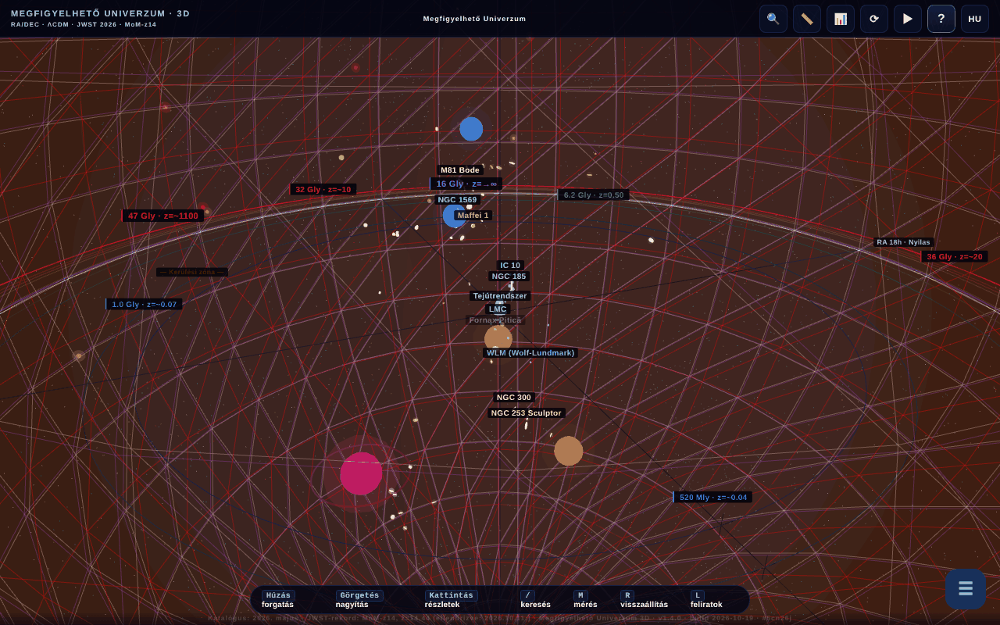

# Universul Observabil 3D

[English](README.md) · [Română](README.ro.md) · [Français](README.fr.md) · [Italiano](README.it.md) · [Español](README.es.md) · [Português](README.pt.md) · [Deutsch](README.de.md) · **Magyar**

**Verzió:** 1.4.10 · **Utolsó frissítés:** 2026-10-23

A felület nyelvei: **Română, English, Français, Italiano, Español, Português (PT), Deutsch, Magyar**

**Élő változat / demó:** https://chiuta.github.io/Universul-Observabil-3D/

A megfigyelhető világegyetem interaktív 3D-térképe egyetlen HTML-fájlban (WebGL / three.js): több mint 115 galaxis (118 a statikus katalógusban), 12 kozmikus horizont, időcsúszka, vezetett túrák, keresés, távolságmérés, kvíz, glTF/CSV-export és BibTeX. 8 nyelvű felület.

**Nyelvek:** a teljes útmutató (11 fül), a 30 vezetett túra (kb. 200 lépés), a 17 „Tudtad?” tény, a bevezető, a 118 galaxis és a 13 horizont/BAO leírása, több tucat objektum neve, a 45,6 Gly-paradoxon ablaka és a kontextuális szójegyzék (10 kifejezés) mind a 8 nyelven elérhető. Változatlanul maradnak: a tulajdonnevek (pl. M81 Bode, Maffei), a kétnyelvű „Limbă / Language” címke, a generált tartalom és a CSV-importok. A fordítások automatikusak; anyanyelvi lektorálás ajánlott (főleg HU/PT/DE). A román forrás néhány vitatható állítást tartalmaz, ezeket hűen, érdemi változtatás nélkül fordítottuk.

- `index.html` — az interaktív 3D alkalmazás;
- `catalog.html` — a katalógus statikus, JavaScript nélküli változata (akadálymentesség és SEO). Ezen a nyelven: [`catalog.hu.html`](catalog.hu.html).

## Az adatokról
A pozíciók, távolságok és tömegek **közelítő és egyszerűsített** értékek, a ΛCDM keretében (Planck 2018) számolva, nyilvános katalógusokból (NED, SIMBAD, a JWST CEERS/JADES/UNCOVER programjai) összegyűjtve. A skála logaritmikus, szemléltető/oktatási célú; nem helyettesíti az eredeti katalógusokat. A „romlandó” állítások (pl. „a legtávolabbi ismert galaxis”, MoM-z14, z=14,44; katalógus „frissítve 2026 májusában”) elavulhatnak. A kozmológiai értékek (a Hubble-állandót is beleértve) bizonytalanságokkal és nyitott feszültségekkel bírnak. A galaxisonkénti források pontos listája nem része az alkalmazásnak.

### „Rekord” állítások és dátumok
A „legtávolabbi galaxis” típusú állítások **a katalógus dátumához (2026. május)** vannak megfogalmazva, és későbbi megfigyelések túlszárnyalhatják őket. Újraellenőrizve 2026.10.11-én: a megtekintett nyilvános forrásokban (STScI/NASA, Wikipédia, sajtó) a MoM-z14 marad a legtávolabbi spektroszkópiailag megerősített galaxis; új rekordot nem találtak. Források: MoM-z14 (z_spec = 14,44) — Naidu és mtsai, arXiv:2505.11263 (2025. májusi preprint, megjelent az Open Journal of Astrophysicsben, 2026. január); JADES-GS-z14-0 — Carniani és mtsai 2024, Nature; EGS-z11-R0 — arXiv:2603.15841 (2026. márciusi bejegyzés, a szerző nem ellenőrizte függetlenül; a spektroszkópiai státuszt itt nem erősítették meg). A nevekben szereplő „ÚJ”/„REKORD” címkéket kifejezett dátumok váltották fel („hozzáadva 2026. márc.”, „rekord (2026. máj.)”). A galaxisonkénti források nincsenek teljes egészében felsorolva; a bibliográfia kiegészítés alatt áll.

## Használat
Nyissa meg az `index.html` fájlt WebGL-t támogató böngészőben. Az `R` billentyű visszaállítja a kamerát, a `/` keres, a `?` megnyitja az útmutatót és a túrát.

## Adatok és adatvédelem
Auditon ellenőrizve: betöltéskor nincs hálózati kérés. A betűtípusok be vannak építve; a választott nyelv és a könyvjelzők a `localStorage`-ban tárolódnak. Az arXiv/külső oldalak felé mutató hivatkozások csak kattintásra nyílnak meg. Van (kikapcsolt, a `MIRROR_URLS` lista üres) kód a tükrök közötti verzióösszehasonlításhoz, amely csak akkor végezne `fetch`-et, ha be lenne állítva. Az `index.html` CSP-je mostantól a `connect-src` értékét `'self'`-re korlátozza (mivel a `MIRROR_URLS` lista üres, a tükörkód nem tud külső kéréseket küldeni; ha beállítja, bővítse a `connect-src`-t a tükrök gazdagépeivel). A beágyazott szkriptek csak a `script-src`-ben szereplő `sha256` hash alapján engedélyezettek: **bármely szkript módosítása után számolja újra a hasheket** a CSP-metában, különben a módosított szkript nem fut.

## Korlátok
- iOS-en a **vászonon** kezdett csípőmozdulatokat a 3D kamera foglalja le; a paneleken és szövegeken a rendszer natív nagyítása elérhető marad (3. kör).
- Az alkalmazás BibTeX-hivatkozásainak („Az alkalmazás hivatkozása” gomb és `catalog.html`) nincs DOI mezője: az alkalmazásnak még nincs Zenodo DOI-ja; a hamis mezőt eltávolították (2. kör).

## Licenc
MIT, a fájlok fejléce szerint; lásd a `LICENSE` fájlt. Az oldalon az ASFAN-România említése is szerepel.

## Jogok és forrásmegjelölés
Az alkalmazás és a kód a szerzőé (MIT licenc, lásd `LICENSE`). A csillagászati adatok nyilvános publikációkból és katalógusokból származnak (NED, SIMBAD, arXiv, Planck 2018); a harmadik felek anyagaihoz fűződő jogok jogtulajdonosaikat illetik, és az MIT licenc nem terjed ki rájuk. Ha Ön jogtulajdonos vagy említett személy, és helyesbítést vagy visszavonást kér, írjon az alexio@trom.tf címre; 7 napon belül válaszolunk.

Audit: 2026-10-10; 2. kör: 2026-10-11 (a helyőrző DOI eltávolítva a hivatkozásokból, `connect-src 'self'`).
3. kör: 2026-10-11 („a katalógus dátumához” megfogalmazások, források a rekordokhoz, az iOS-gesztusok a vászonra korlátozva).

## 2026.10.11-én ellenőrzött források
- A MoM-z14 távolsági rekordja: https://www.stsci.edu/contents/news-releases/2026/news-2026-107 (2026. január 28-i közlemény), https://en.wikipedia.org/wiki/MoM-z14 és https://en.wikipedia.org/wiki/List_of_the_most_distant_astronomical_objects — nem találtak távolabbi spektroszkópiai rekordot. A katalógus adatai a 2026. májusiak maradnak (az EGS-z11-R0 függetlenül nem ellenőrzött marad).

## Előzmények / Changelog

### 1.4.10 — 2026-10-23
- fff-kit 1.2.0: az összes böngészőkulcs (nyelv, könyvjelzők, teljesítményválasztás, bevezető, finom indítás) mostantól a `universul-observabil-3d.` előtagot viseli; a régieket (`up3_lang`, `univers_obs_bk`, `up3-perf-*`, `up3-onboarded-v2`, `up3-gentle-start`) az alkalmazás induláskor automatikusan átköltözteti, így a meglévő könyvjelzők és beállítások megmaradnak, régi .fff.json mentés importálása után is. A „hivatkozás másolása” tartalék már nem a böngésző natív ablakát, hanem egy akadálymentes párbeszédablakot használ.

### 1.4.8 — 2026-10-22
- fff-kit 1.1.4: érintési célpontok és minimális szövegméret; érintési célpontok/szöveg javítva

### 1.4.7 — 2026-10-22
- fff-kit 1.1.2: PBKDF2 600 000 iterációval, clickjacking elleni védelem.

### 1.4.6 — 2026-10-22
- Valóban offline: a beágyazott manifestet (data: URL) valódi sw.js (előbb gyorsítótár, háttér-újraellenőrzéssel), webes manifestfájl és ikonok váltották fel; az alkalmazás az első látogatás után hálózat nélkül is megnyílik, és telepíthető.
- Akadálymentesség: az oldalon mostantól pontosan egy H1 van (a címsor); a CSV-importmező és a skálafaktor-csúszka a képernyőolvasók által felolvasott névvel rendelkezik (8 nyelv); az idő- és a távolságszűrő csúszkáinak érintési felülete 24 px.
- Mobil: a felület szövege legalább 12 px, a tereppontok gombjainak érintési felülete pedig nagyobb.

- **1.4.5 — 2026-10-22:** a „egys.” rövidítés a együttmozgó rács widget sajáttávolság-kijelzőjében mostantól a felület nyelvét követi.
- **1.4.4 — 2026-10-22:** a bevezető útmutató összes gombfelirata és a távolságcsúszka jelzőpontjai („Kamera visszaállítása”, „Repülés az Androméda-galaxisig”, „A CMB felé” …) mind a 8 nyelven le vannak fordítva.
- **1.4.3 — 2026-10-22:** az oldal címe és a meta-leírások követik a felület nyelvét; az „R reset” súgó románul is lokalizált („resetare”).
- **1.4.2 — 2026-10-19:** 20 objektumnév lefordítva a 3D-címkékben, a panelen és a keresésben; a 45,6 Gly-paradoxon ablaka teljesen lefordítva; a kontextuális szójegyzék mostantól minden nyelven működik (10 kifejezés × 7 nyelv, nyelvváltáskor újra alkalmazva); javítva: a „💡 TUDTAD?” fr nyelven románul maradt, valamint a vászon aria-label-je és a „‹ Vissza” gomb.
- **1.4.1 — 2026-10-19:** a teljes útmutató (11 fül), a 30 túra, a „Tudtad?” tények, a bevezető és a galaxisok/horizontok leírása le van fordítva en, fr, it, es, pt, de, hu nyelvre; az útmutató/túra nyelvváltáskor újra megjelenik.
- 1.3.0 — 2026-10-14: Biztonsági mentés és adatcímkézés (fff-kit).
- **1.2.4 — 2026. október 12.:** a verzió és az utolsó frissítés dátuma megjelenik az alkalmazásban (Útmutató párbeszédablak).
- **1.2.3 — 2026. október 11.:** a `/` billentyű (vagy Ctrl/Cmd+K) azonnal a keresőmezőre helyezi a fókuszt, így a gépelés lassú 3D-renderelésnél sem vész el; keskeny képernyőkön (≤700 px) az üdvözlő útmutató már nem nyílik meg automatikusan a jelenet fölött, hanem a „?” gomb pulzál, amíg meg nem érinti; 0 hiba, axe 0 szabálysértés 1280×800 és 360×740 méretnél.
- **1.2.2 — 2026. október 11.:** CSP `sha256` hashsel a négy beágyazott szkripthez (`'unsafe-inline'` és `blob:` nélkül a `script-src`-ben); „Akadálymentes szövegkatalógus (JavaScript nélkül)” hivatkozás a `catalog.html` felé, az oldal első fókuszálható eleme (fókuszkor látható, RO/EN), valamint a `noscript` üzenetben, a WebGL-jelenet szöveges alternatívájaként képernyőolvasóknak és billentyűzetnek; 1.2.2 verzió (alkalmazás, `catalog.html`, BibTeX-hivatkozás).
- **1.2.1 — 2026. október 11.:** a keresőmezőben mostantól működik a ↑/↓/Enter/Esc (korábban a globális kezelő figyelmen kívül hagyta az INPUT-ból érkező eseményeket); az egymást fedő 3D-címkék prioritás szerint automatikusan elrejtődnek (horizontok, majd a galaxisok távolság szerinti sorrendben) ahelyett, hogy összekeverednének; az üdvözlő túra az első megnyitáskor láttnak lesz jelölve, így ha ✕/Esc-szel bezárták, már nem nyílik meg újra minden betöltéskor.
- Akadálymentesség/rendrakás: `main` / `complementary` eligazodási pontok (axe-core: 0 szabálysértés 1280×800 és 360×740 méretnél), `catalog.html`: a táblázatok keskeny képernyőn vízszintesen görgethetők (360 px-en nincs oldalkilógás); a beágyazott `onclick` eseménykezelő eltávolítva (az „Exportálás CSV-be” gomb a hivatkozástáblázatban), 2026-10-11-i build-dátum az alkalmazásban, a `catalog.html`-ben és a metákban, a verziószám mindenhol frissítve.
