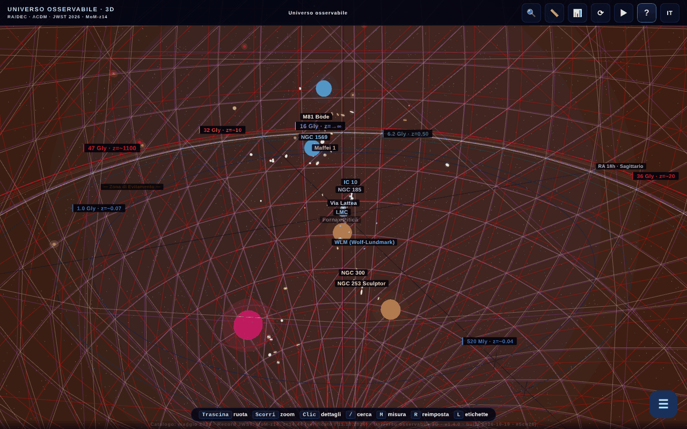

# Universul Observabil 3D

[English](README.md) · [Română](README.ro.md) · [Français](README.fr.md) · **Italiano** · [Español](README.es.md) · [Português](README.pt.md) · [Deutsch](README.de.md) · [Magyar](README.hu.md)

**Versione:** 2.1.0 · **Ultimo aggiornamento:** 2026-10-27

**Stato:** stabile · **Offline:** completo

Lingue dell'interfaccia: **Română, English, Français, Italiano, Español, Português (PT), Deutsch, Magyar**

**Online / demo:** https://chiuta.github.io/Universul-Observabil-3D/

Mappa 3D interattiva dell'universo osservabile, in un unico file HTML (WebGL / three.js): oltre 115 galassie (118 nel catalogo statico), 12 orizzonti cosmici, cursore del tempo, tour guidati, ricerca, misurazione di distanze, quiz, esportazione glTF/CSV e BibTeX. Interfaccia in 8 lingue.

**Lingue:** la guida completa (11 schede), i 30 tour guidati (circa 200 passi), i 17 «Lo sapevi?», l'onboarding, le descrizioni delle 118 galassie e dei 13 orizzonti/BAO, i nomi di decine di oggetti, la finestra del paradosso da 45,6 Gal e il glossario contestuale (10 termini) sono disponibili nelle 8 lingue. Restano invariati: i nomi propri (ad es. M81 Bode, Maffei), l'etichetta bilingue «Limbă / Language», il contenuto generato e le importazioni CSV. Le traduzioni sono automatiche; si consiglia una revisione da madrelingua (soprattutto HU/PT/DE). La fonte rumena contiene alcune affermazioni discutibili, tradotte fedelmente senza modifiche di sostanza.

- `index.html` — l'applicazione 3D interattiva;
- `catalog.html` — versione statica, senza JavaScript, del catalogo (accessibilità e SEO). In questa lingua: [`catalog.it.html`](catalog.it.html).

## Sui dati
Posizioni, distanze e masse sono valori **approssimativi e semplificati**, calcolati nel quadro ΛCDM (Planck 2018) e raccolti da cataloghi pubblici (NED, SIMBAD, programmi JWST CEERS/JADES/UNCOVER). La scala è logaritmica e ha scopo illustrativo/educativo; non sostituisce i cataloghi originali. Affermazioni «deperibili» (ad es. «la galassia più lontana conosciuta», MoM-z14, z=14,44; catalogo «aggiornato a maggio 2026») possono diventare obsolete. I valori cosmologici (compresa la costante di Hubble) hanno incertezze e tensioni aperte. L'elenco esatto delle fonti per ogni galassia non è incluso nell'applicazione.

### Affermazioni di «record» e date
Le affermazioni del tipo «la galassia più lontana» sono formulate **alla data del catalogo (maggio 2026)** e possono essere superate da osservazioni successive. Riverificato l'11.10.2026: nelle fonti pubbliche consultate (STScI/NASA, Wikipedia, stampa) MoM-z14 resta la galassia più lontana confermata spettroscopicamente; non è stato trovato nessun nuovo record. Fonti: MoM-z14 (z_spec = 14,44) — Naidu et al., arXiv:2505.11263 (preprint di maggio 2025, pubblicato su Open Journal of Astrophysics, gennaio 2026); JADES-GS-z14-0 — Carniani et al. 2024, Nature; EGS-z11-R0 — arXiv:2603.15841 (voce di marzo 2026, non verificata indipendentemente dall'autore; lo stato spettroscopico non è stato confermato qui). Le etichette «NUOVO»/«RECORD» nei nomi sono state sostituite da date esplicite («aggiunta mar. 2026», «record (mag. 2026)»). Le fonti per ogni galassia non sono elencate integralmente; la bibliografia è in corso di completamento.

## Uso
Apri `index.html` in un browser con WebGL. Il tasto `R` reimposta la telecamera, `/` cerca, `?` apre la guida e il tour.

## Dati e privacy
Verificato con audit: nessuna richiesta di rete al caricamento. I font sono inclusi; la lingua scelta e i segnalibri sono conservati in `localStorage`. I link verso arXiv/siti esterni si aprono solo al clic. Esiste del codice (disattivato, l'elenco `MIRROR_URLS` è vuoto) per il confronto di versioni tra mirror, che farebbe un `fetch` solo se configurato. La CSP in `index.html` limita ora `connect-src` a `'self'` (essendo vuoto l'elenco `MIRROR_URLS`, il codice dei mirror non può fare richieste esterne; se lo configuri, estendi `connect-src` con gli host dei mirror). Gli script inline sono consentiti solo tramite hash `sha256` in `script-src`: **dopo ogni modifica di uno script, ricalcola gli hash** nel meta CSP, altrimenti lo script modificato non viene eseguito.

## Limiti
- Su iOS, i gesti di pinch iniziati **sul canvas** sono riservati alla telecamera 3D; su pannelli e testi, lo zoom nativo del sistema resta disponibile (round 3).
- Le citazioni BibTeX dell'applicazione (pulsante «Cita questa applicazione» e `catalog.html`) non hanno il campo DOI: l'applicazione non ha ancora un DOI Zenodo; il campo falso è stato rimosso (round 2).

## Licenza
MIT, secondo l'intestazione dei file; vedi `LICENSE`. La pagina riporta anche menzioni di ASFAN-România.

## Diritti e attribuzione
L'applicazione e il codice appartengono all'autore (licenza MIT, vedi `LICENSE`). I dati astronomici provengono da pubblicazioni e cataloghi pubblici (NED, SIMBAD, arXiv, Planck 2018); i diritti sui materiali di terzi appartengono ai rispettivi titolari e la licenza MIT non li copre. Se sei titolare di diritti o una persona menzionata e desideri la correzione o il ritiro, scrivi a alexio@trom.tf; rispondiamo entro 7 giorni.

Audit: 2026-10-10; round 2: 2026-10-11 (rimosso il DOI segnaposto dalle citazioni, `connect-src 'self'`).
Round 3: 2026-10-11 (formulazioni «alla data del catalogo», fonti per i record, gesti iOS limitati al canvas).

## Fonti verificate l'11.10.2026
- Il record di distanza MoM-z14: https://www.stsci.edu/contents/news-releases/2026/news-2026-107 (comunicato del 28 gennaio 2026), https://en.wikipedia.org/wiki/MoM-z14 e https://en.wikipedia.org/wiki/List_of_the_most_distant_astronomical_objects — nessun record spettroscopico più lontano trovato. I dati del catalogo restano quelli di maggio 2026 (EGS-z11-R0 resta non verificato indipendentemente).

## Dimensione dei cataloghi nella serie (2.0.1)

- **Numeri.** Hub: 112 voci (copia identica del catalogo 1D). 1D: 112. 2D: 112 (111 galassie + l'orizzonte CMB; alcuni testi dicono 111). 3D: 118 («oltre 115» nelle descrizioni). I numeri differiscono perché i cataloghi sono separati, non per un errore di conteggio.
- **Non unificati.** La 3D ha un catalogo proprio, con struttura diversa (AR in ore, altri nomi e grafie), quindi i suoi nomi coincidono solo in parte con 1D/2D. L'unione in un unico file comune non è stata fatta: ogni app è un singolo file offline senza passaggio di build comune, e unire cambierebbe i dati in tre app senza modo di validarli qui. Segnalato all'autore.
- **Conflitto noto 1D ↔ 2D (non corretto, da verificare con fonti).** I due cataloghi hanno gli stessi 112 nomi, ma 8 voci hanno una distanza diversa (d = tempo di sguardo all'indietro, in Mal, 1D→2D): NGC 1132 330→1020, Perseus (BCG IC 310) 270→780, 3C 48 4150→5200, Abell 370 4200→5900, CL 0024+1654 4400→5500, SDSS J1004+4112 10050→7000, IC 4296 180→130, Abell 1689 2330→7200; e il segno del redshift di Andromeda (M31) è −0,001 in 1D e +0,001 in 2D.

## Record JWST riverificati (27.10.2026)

- **MoM-z14:** z = 14,44, ancora la galassia più lontana confermata spettroscopicamente (Naidu et al., arXiv:2505.11263; pubblicato su Open Journal of Astrophysics, gen. 2026).
- **JADES-GS-z14-0:** NIRSpec z = 14,32 (+0,08/−0,20) (Carniani et al. 2024, Nature); ALMA [OIII] 88 µm z = 14,1793 ± 0,0007 (Schouws et al. 2025, arXiv:2409.20549), compatibile. Il catalogo mantiene il valore NIRSpec; il valore ALMA è indicato nella descrizione.
- **PAN-z14-1:** z = 13,53 (+0,05/−0,06), JWST/NIRSpec (Donnan et al., arXiv:2601.11515, gen. 2026): quarta per distanza, non un record. Non aggiunta al catalogo (coordinate non verificate), solo citata nella nota di MoM-z14.

## JWST note in 8 languages (2.1.0)

_(English only; not yet translated into this language. Machine translation intentionally not added to avoid errors in technical statements.)_

- The citation note for JADES-GS-z14-0 ("Record JWST: z=14.32 NIRSpec; ALMA [OIII]88µm z=14.1793 (Schouws+ 2025, arXiv:2409.20549)") is now translated through the existing UI dictionary (`UI_DICT`) into en/fr/it/es/pt/de/hu — a **machine translation** of the "Record JWST" part; the ALMA/arXiv part is language-neutral. Existing keys were not modified.
- The 3D catalogue (118 entries) stays separate; the 1D↔2D discrepancies are in the 1D/2D/hub repositories (`docs/DISCREPANTE.md`). Catalogue merging: not done.

## Storico / Changelog

### 2.1.0 — 2026-10-27
- JWST note machine-translated.

### 1.4.11 — 2026-10-23
- Segnalibri: dati `localStorage` corrotti (non una lista, voci nulle/non numeriche) non bloccano più l'app — vengono ignorati; la versione mostrata nel piè di pagina/«Informazioni» e nella citazione è di nuovo quella reale.

### 1.4.10 — 2026-10-23
- fff-kit 1.2.0: tutte le chiavi del browser (lingua, segnalibri, scelta delle prestazioni, introduzione, avvio morbido) portano ora il prefisso `universul-observabil-3d.`; quelle vecchie (`up3_lang`, `univers_obs_bk`, `up3-perf-*`, `up3-onboarded-v2`, `up3-gentle-start`) vengono migrate automaticamente all'avvio, quindi segnalibri e impostazioni esistenti restano, anche dopo l'importazione di una vecchia copia .fff.json. L'alternativa «copia il link» non usa più la finestra nativa del browser, ma un dialogo accessibile.

### 1.4.8 — 2026-10-22
- fff-kit 1.1.4: bersagli touch e testo minimo; bersagli touch/testo corretti

### 1.4.7 — 2026-10-22
- fff-kit 1.1.2: PBKDF2 a 600.000 iterazioni, protezione anti-clickjacking.

### 1.4.6 — 2026-10-22
- Offline davvero: il manifest incorporato (URL data:) è stato sostituito da un vero sw.js (cache first con rivalidazione in background), da un file manifest web e da icone; l'app ora si apre senza rete dopo la prima visita e può essere installata.
- Accessibilità: la pagina ha ora esattamente un H1 (la barra del titolo); il campo di importazione CSV e il cursore del fattore di scala hanno un nome annunciato dagli screen reader (8 lingue); i cursori del tempo e del filtro di distanza hanno aree tattili di 24 px.
- Mobile: il testo dell'interfaccia è di almeno 12 px e i pulsanti dei punti di riferimento hanno aree tattili più grandi.

- **1.4.5 — 2026-10-22:** l’abbreviazione «unità» nella lettura della distanza propria del widget della griglia comovente segue ora la lingua dell’interfaccia.
- **1.4.4 — 2026-10-22:** tutte le etichette dei pulsanti della guida introduttiva e i riferimenti del cursore di distanza («Reimposta la camera», «Vola fino ad Andromeda», «Verso la CMB»…) sono tradotti nelle 8 lingue.
- **1.4.3 — 2026-10-22:** il titolo della pagina e le meta-descrizioni seguono la lingua dell'interfaccia; il suggerimento «R reset» è localizzato in rumeno («resetare»).
- **1.4.2 — 2026-10-19:** tradotti 20 nomi di oggetti nelle etichette 3D, nel pannello e nella ricerca; finestra del paradosso da 45,6 Gal tradotta integralmente; il glossario contestuale ora funziona in tutte le lingue (10 termini × 7 lingue, riapplicato al cambio di lingua); corretto «💡 LO SAPEVI» rimasto in rumeno in fr, più l'aria-label del canvas e il pulsante «‹ Indietro».
- **1.4.1 — 2026-10-19:** la guida completa (11 schede), i 30 tour, i «Lo sapevi?», l'onboarding e le descrizioni di galassie/orizzonti sono tradotti in en, fr, it, es, pt, de, hu; guida/tour vengono riproposti al cambio di lingua.
- 1.3.0 — 2026-10-14: Copia di riserva ed etichettatura dei dati (fff-kit).
- **1.2.4 — 12 ottobre 2026:** la versione e la data dell'ultimo aggiornamento sono mostrate nell'applicazione (finestra Guida).
- **1.2.3 — 11 ottobre 2026:** il tasto `/` (o Ctrl/Cmd+K) sposta subito il focus nel campo di ricerca, quindi la digitazione non si perde più nemmeno quando il rendering 3D è lento; sugli schermi stretti (≤700 px) la guida di benvenuto non si apre più automaticamente sopra la scena, ma il pulsante «?» pulsa finché non lo tocchi; 0 errori, axe 0 violazioni a 1280×800 e 360×740.
- **1.2.2 — 11 ottobre 2026:** CSP con hash `sha256` per i quattro script inline (senza `'unsafe-inline'` e senza `blob:` in `script-src`); link «Catalogo testuale accessibile (senza JavaScript)» verso `catalog.html`, primo elemento focalizzabile della pagina (visibile al focus, RO/EN) e nel messaggio `noscript`, come alternativa testuale alla scena WebGL per screen reader e tastiera; versione 1.2.2 (applicazione, `catalog.html`, citazione BibTeX).
- **1.2.1 — 11 ottobre 2026:** nel campo di ricerca funzionano ora ↑/↓/Invio/Esc (prima il gestore globale ignorava gli eventi da INPUT); le etichette 3D sovrapposte si nascondono automaticamente per priorità (orizzonti, poi galassie in ordine di distanza) invece di confondersi; il tour di benvenuto viene contrassegnato come visto alla prima apertura, quindi non si riapre a ogni caricamento se è stato chiuso con ✕/Esc.
- Accessibilità/pulizia: punti di riferimento `main` / `complementary` (axe-core: 0 violazioni a 1280×800 e 360×740), `catalog.html`: le tabelle scorrono orizzontalmente sugli schermi stretti (senza trabocco della pagina a 360 px); gestore inline `onclick` rimosso (il pulsante «Esporta CSV» nella tabella delle citazioni), data di build 2026-10-11 nell'applicazione, `catalog.html` e meta, numero di versione aggiornato ovunque.
