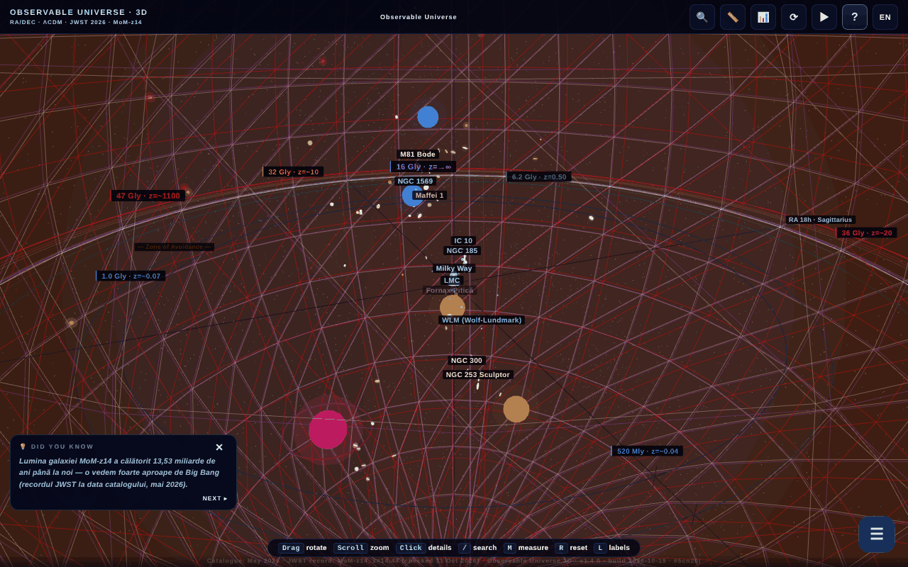

# Universul Observabil 3D

**English** · [Română](README.ro.md) · [Français](README.fr.md) · [Italiano](README.it.md) · [Español](README.es.md) · [Português](README.pt.md) · [Deutsch](README.de.md) · [Magyar](README.hu.md)

**Version:** 2.0.1 · **Last updated:** 2026-10-27

**Status:** stable · **Offline:** fully offline

Interface languages: **Română, English, Français, Italiano, Español, Português (PT), Deutsch, Magyar**

**Live / demo:** https://chiuta.github.io/Universul-Observabil-3D/

An interactive 3D map of the observable universe, in a single HTML file (WebGL / three.js): over 115 galaxies (118 in the static catalog), 12 cosmic horizons, a time slider, guided tours, search, distance measurement, a quiz, glTF/CSV export and BibTeX. Interface in 8 languages.

**Languages:** the complete guide (11 tabs), the 30 guided tours (about 200 steps), the 17 "Did you know?" facts, the onboarding, the descriptions of the 118 galaxies and of the 13 horizons/BAO, the names of dozens of objects, the 45.6 Gly paradox dialog and the contextual glossary (10 terms) are available in the 8 languages. Left as they are: proper names (e.g. M81 Bode, Maffei), the bilingual "Limbă / Language" label, generated content and CSV imports. The translations are automatic; a native review is recommended (especially HU/PT/DE). The Romanian source contains a few debatable statements, translated faithfully without changes of substance.

- `index.html` — the interactive 3D application;
- `catalog.html` — a static, JavaScript-free version of the catalog (accessibility and SEO). English version: [`catalog.en.html`](catalog.en.html).

## About the data
Positions, distances and masses are **approximate and simplified** values, computed within ΛCDM (Planck 2018) and compiled from public catalogs (NED, SIMBAD, the JWST programs CEERS/JADES/UNCOVER). The scale is logarithmic and is meant for illustration/education; it does not replace the original catalogs. "Perishable" claims (e.g. "the most distant known galaxy", MoM-z14, z=14.44; catalog "updated in May 2026") may become outdated. The cosmological values (including the Hubble constant) have uncertainties and open tensions. The exact list of sources per galaxy is not included in the application.

### "Record" claims and dates
Claims of the "most distant galaxy" type are worded **as of the catalog date (May 2026)** and may be surpassed by later observations. Rechecked on 11.10.2026: in the public sources consulted (STScI/NASA, Wikipedia, press) MoM-z14 remains the most distant spectroscopically confirmed galaxy; no new record was found. Sources: MoM-z14 (z_spec = 14.44) — Naidu et al., arXiv:2505.11263 (preprint May 2025, published in the Open Journal of Astrophysics, January 2026); JADES-GS-z14-0 — Carniani et al. 2024, Nature; EGS-z11-R0 — arXiv:2603.15841 (entry from March 2026, not independently verified by the author; the spectroscopic status was not confirmed here). The "NEW"/"RECORD" labels in the names were replaced with explicit dates ("added Mar. 2026", "record (May 2026)"). The sources per galaxy are not listed in full; the bibliography is being completed.

## Usage
Open `index.html` in a browser with WebGL. The `R` key resets the camera, `/` searches, `?` opens the guide and the tour.

### My tours (2.0.0)
In the drawer, section "🧭 My tours": press "Record a new tour", move the camera, optionally type a note and press "＋ Add point"; repeat, then "✔ Save tour". The tour plays in the same panel as the guided tours (previous/next, pause), is kept in the browser (`universul-observabil-3d.tours`, up to 20 tours × 60 points) and is shared as a `.json` file (⬇ export / "Import a tour"). The file holds only the camera position, the duration and your notes; on import all content is validated, bounded and treated strictly as text (no HTML). Nothing is sent over the network. **Not implemented:** WebXR export (there is no safe, offline, testable path for it in this app).

## Data and privacy
Verified by audit: no network requests on load. The fonts are included; the chosen language and bookmarks are kept in `localStorage`. Links to arXiv/external sites open only on click. There is code (disabled, the `MIRROR_URLS` list is empty) for comparing versions between mirrors, which would do a `fetch` only if configured. The CSP in `index.html` now limits `connect-src` to `'self'` (since the `MIRROR_URLS` list is empty, the mirror code cannot make external requests; if you configure it, extend `connect-src` with the mirrors' hosts). Inline scripts are allowed only through a `sha256` hash in `script-src`: **after any modification of a script, recompute the hashes** in the CSP meta, otherwise the modified script does not run.

## Limitations
- On iOS, pinch gestures started **on the canvas** are reserved for the 3D camera; on panels and texts, the system's native zoom remains available (round 3).
- The application's BibTeX citations ("Cite this application" button and `catalog.html`) have no DOI field: the application does not yet have a Zenodo DOI; the fake field was removed (round 2).

## License
MIT, according to the header of the files; see `LICENSE`. The page also carries mentions of ASFAN-România.

## Rights and attribution
The application and the code belong to the author (MIT license, see `LICENSE`). The astronomical data come from public publications and catalogs (NED, SIMBAD, arXiv, Planck 2018); the rights over third-party materials belong to their holders, and the MIT license does not cover them. If you are a rights holder or a person mentioned and wish to have something corrected or withdrawn, write to alexio@trom.tf; we reply within 7 days.

Audit: 2026-10-10; round 2: 2026-10-11 (removed the placeholder DOI from the citations, `connect-src 'self'`).
Round 3: 2026-10-11 ("as of the catalog date" wordings, sources for records, iOS gestures limited to the canvas).

## Sources verified on 11.10.2026
- The distance record MoM-z14: https://www.stsci.edu/contents/news-releases/2026/news-2026-107 (press release of 28 January 2026), https://en.wikipedia.org/wiki/MoM-z14 and https://en.wikipedia.org/wiki/List_of_the_most_distant_astronomical_objects — no more distant spectroscopic record found. The catalog data remain those from May 2026 (EGS-z11-R0 remains independently unverified).

## Catalogue sizes across the series (2.0.1)

- **Counts.** Hub: 112 entries (a copy of the 1D catalogue, identical). 1D: 112. 2D: 112 (111 galaxies + the CMB horizon; some texts say 111). 3D: 118 ("over 115" in the descriptions). The numbers differ because the catalogues are separate, not because of a counting error.
- **Not unified.** 3D has its own catalogue in a different structure (RA in hours, other names and spellings), so its names only partly match 1D/2D. Merging into one shared file was not done: each app is a single offline file with no shared build step, and merging would change data in three apps without a way to validate it here. Flagged for the author.
- **Known 1D ↔ 2D conflict (not corrected, to verify with sources).** The two catalogues have the same 112 names, but 8 entries have a different distance (d = lookback, in Mly, 1D→2D): NGC 1132 330→1020, Perseus (BCG IC 310) 270→780, 3C 48 4150→5200, Abell 370 4200→5900, CL 0024+1654 4400→5500, SDSS J1004+4112 10050→7000, IC 4296 180→130, Abell 1689 2330→7200; and the sign of the redshift of Andromeda (M31) is −0.001 in 1D and +0.001 in 2D.

## JWST records re-verified (27.10.2026)

- **MoM-z14:** z = 14.44, still the most distant spectroscopically confirmed galaxy (Naidu et al., arXiv:2505.11263; published in the Open Journal of Astrophysics, Jan. 2026).
- **JADES-GS-z14-0:** NIRSpec z = 14.32 (+0.08/−0.20) (Carniani et al. 2024, Nature); ALMA [OIII] 88 µm z = 14.1793 ± 0.0007 (Schouws et al. 2025, arXiv:2409.20549), consistent with it. The catalogue keeps the NIRSpec value; the ALMA value is noted in the description.
- **PAN-z14-1:** z = 13.53 (+0.05/−0.06), JWST/NIRSpec (Donnan et al., arXiv:2601.11515, Jan. 2026): fourth in distance, not a record. Not added to the catalogue (its coordinates were not verified), only mentioned in the MoM-z14 note.

## History / Changelog

### 2.0.0 — 2026-10-26
- User-made tours: record camera points with notes, play them back, export/import as a JSON file.

### 1.4.11 — 2026-10-23
- Bookmarks: corrupted `localStorage` data (not a list, null/non-numeric entries) no longer breaks the app — it is ignored; the version shown in the footer/“About” and in the citation is the real one again.

### 1.4.10 — 2026-10-23
- fff-kit 1.2.0: all browser keys (language, bookmarks, performance choice, onboarding, gentle start) now carry the `universul-observabil-3d.` prefix; the old ones (`up3_lang`, `univers_obs_bk`, `up3-perf-*`, `up3-onboarded-v2`, `up3-gentle-start`) are migrated automatically at start-up, so existing bookmarks and settings are kept, also after importing an old .fff.json backup. The “copy link” fallback no longer uses the native browser prompt but an accessible dialog.

### 1.4.8 — 2026-10-22
- fff-kit 1.1.4: touch targets and minimum text size; touch targets/text fixed

### 1.4.7 — 2026-10-22
- fff-kit 1.1.2: PBKDF2 600,000 iterations, anti-clickjacking protection.

### 1.4.6 — 2026-10-22
- Offline for real: the inline (data: URL) manifest was replaced by a real sw.js (cache-first with background revalidation), a web manifest file and icons; the app now opens without network after the first visit and can be installed.
- Accessibility: the page now has exactly one H1 (the title bar); the CSV import field and the scale-factor slider have names announced by screen readers (8 languages); the time and distance-filter sliders have 24 px touch targets.
- Mobile: interface text is at least 12 px and the landmark buttons are larger touch targets.

- **1.4.5 — 2026-10-22:** the “units” abbreviation in the proper-distance readout of the comoving-grid widget now follows the interface language.
- **1.4.4 — 2026-10-22:** all button labels in the intro guide and the distance-slider landmarks (“Reset camera”, “Fly to Andromeda”, “Towards the CMB”…) are now translated in all 8 languages.
- **1.4.3 — 2026-10-22:** the page title and meta descriptions follow the interface language; the "R reset" hint is localized in Romanian ("resetare").
- **1.4.2 — 2026-10-19:** 20 object names in the 3D labels, the panel and the search translated; the 45.6 Gly paradox dialog fully translated; the contextual glossary now works in all languages (10 terms × 7 languages, re-applied on language change); fixed "💡 DID YOU KNOW" left in Romanian in fr, plus the canvas aria-label and the "‹ Back" button.
- **1.4.1 — 2026-10-19:** the complete guide (11 tabs), the 30 tours, the "Did you know?" facts, the onboarding and the galaxy/horizon descriptions translated into en, fr, it, es, pt, de, hu; the guide/tour is redisplayed when the language changes.
- 1.3.0 — 2026-10-14: Backup and data labeling (fff-kit).
- **1.2.4 — 12 October 2026:** the version and the date of the last update are shown in the application (Guide dialog).
- **1.2.3 — 11 October 2026:** the `/` key (or Ctrl/Cmd+K) moves focus immediately into the search field, so typing is no longer lost even when 3D rendering is slow; on narrow screens (≤700 px) the welcome guide no longer opens automatically over the scene, but the "?" button pulses until you touch it; 0 errors, axe 0 violations at 1280×800 and 360×740.
- **1.2.2 — 11 October 2026:** CSP with a `sha256` hash for the four inline scripts (no `'unsafe-inline'` and no `blob:` in `script-src`); a "Accessible text catalog (no JavaScript)" link to `catalog.html`, the first focusable element on the page (visible on focus, RO/EN) and in the `noscript` message, as a textual alternative to the WebGL scene for screen readers and keyboard; version 1.2.2 (application, `catalog.html`, BibTeX citation).
- **1.2.1 — 11 October 2026:** ↑/↓/Enter/Esc now work in the search field (before, the global handler ignored events from INPUT); overlapping 3D labels are hidden automatically by priority (horizons, then galaxies in order of distance) instead of mixing together; the welcome tour is marked as seen on first opening, so it no longer reopens on every load if it was closed with ✕/Esc.
- Accessibility/cleanup: `main` / `complementary` landmarks (axe-core: 0 violations at 1280×800 and 360×740), `catalog.html`: tables scroll horizontally on narrow screens (no page overflow at 360 px); inline `onclick` handler removed (the "Export CSV" button in the citations table), build date 2026-10-11 in the application, `catalog.html` and metas, version number updated everywhere.
