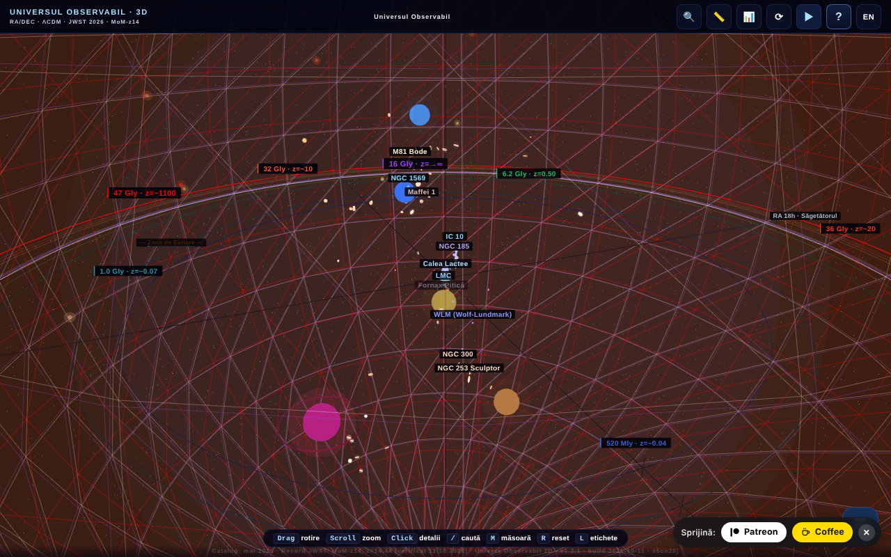

# Universul Observabil 3D

**English** · [Română](README.ro.md) · [Français](README.fr.md) · [Italiano](README.it.md) · [Español](README.es.md) · [Português](README.pt.md) · [Deutsch](README.de.md) · [Magyar](README.hu.md)

**Version:** 1.4.0 · **Last updated:** 2026-10-19

Interface languages: **Română, English, Français, Italiano, Español, Português (PT), Deutsch, Magyar**

**Live / demo:** https://chiuta.github.io/Universul-Observabil-3D/

An interactive 3D map of the observable universe, in a single HTML file (WebGL / three.js): over 115 galaxies (118 in the static catalog), 12 cosmic horizons, a time slider, guided tours, search, distance measurement, a quiz, glTF/CSV export and BibTeX. Interface in 8 languages.

- `index.html` — the interactive 3D application;
- `catalog.html` — a static, JavaScript-free version of the catalog (accessibility and SEO).

## About the data
Positions, distances and masses are **approximate and simplified** values, computed within ΛCDM (Planck 2018) and compiled from public catalogs (NED, SIMBAD, the JWST programs CEERS/JADES/UNCOVER). The scale is logarithmic and is meant for illustration/education; it does not replace the original catalogs. "Perishable" claims (e.g. "the most distant known galaxy", MoM-z14, z=14.44; catalog "updated in May 2026") may become outdated. The cosmological values (including the Hubble constant) have uncertainties and open tensions. The exact list of sources per galaxy is not included in the application.

### "Record" claims and dates
Claims of the "most distant galaxy" type are worded **as of the catalog date (May 2026)** and may be surpassed by later observations. Rechecked on 11.10.2026: in the public sources consulted (STScI/NASA, Wikipedia, press) MoM-z14 remains the most distant spectroscopically confirmed galaxy; no new record was found. Sources: MoM-z14 (z_spec = 14.44) — Naidu et al., arXiv:2505.11263 (preprint May 2025, published in the Open Journal of Astrophysics, January 2026); JADES-GS-z14-0 — Carniani et al. 2024, Nature; EGS-z11-R0 — arXiv:2603.15841 (entry from March 2026, not independently verified by the author; the spectroscopic status was not confirmed here). The "NEW"/"RECORD" labels in the names were replaced with explicit dates ("added Mar. 2026", "record (May 2026)"). The sources per galaxy are not listed in full; the bibliography is being completed.

## Usage
Open `index.html` in a browser with WebGL. The `R` key resets the camera, `/` searches, `?` opens the guide and the tour.

## Data and privacy
Verified by audit: no network requests on load. The fonts are included; the chosen language and bookmarks are kept in `localStorage`. Links to arXiv/external sites open only on click. There is code (disabled, the `MIRROR_URLS` list is empty) for comparing versions between mirrors, which would do a `fetch` only if configured. The CSP in `index.html` now limits `connect-src` to `'self'` (since the `MIRROR_URLS` list is empty, the mirror code cannot make external requests; if you configure it, extend `connect-src` with the mirrors' hosts). Inline scripts are allowed only through a `sha256` hash in `script-src`: **after any modification of a script, recompute the hashes** in the CSP meta, otherwise the modified script does not run.

## Limitations
- On iOS, pinch gestures started **on the canvas** are reserved for the 3D camera; on panels and texts, the system's native zoom remains available (round 3).
- The application's BibTeX citations ("Cite this application" button and `catalog.html`) have no DOI field: the application does not yet have a Zenodo DOI; the fake field was removed (round 2).

## License
MIT, according to the header of the files; see `LICENSE`. The page also carries mentions of ASFAN-România.

## Rights and attribution
The application and the code belong to the author (MIT license, see `LICENSE`). The astronomical data come from public publications and catalogs (NED, SIMBAD, arXiv, Planck 2018); the rights over third-party materials belong to their holders, and the MIT license does not cover them. If you are a rights holder or a person mentioned and wish to have something corrected or withdrawn, write to alexio@trom.tf; we reply within 7 days.

Audit: 2026-10-10; round 2: 2026-10-11 (removed the placeholder DOI from the citations, `connect-src 'self'`).
Round 3: 2026-10-11 ("as of the catalog date" wordings, sources for records, iOS gestures limited to the canvas).

## Sources verified on 11.10.2026
- The distance record MoM-z14: https://www.stsci.edu/contents/news-releases/2026/news-2026-107 (press release of 28 January 2026), https://en.wikipedia.org/wiki/MoM-z14 and https://en.wikipedia.org/wiki/List_of_the_most_distant_astronomical_objects — no more distant spectroscopic record found. The catalog data remain those from May 2026 (EGS-z11-R0 remains independently unverified).

## History / Changelog

- 1.3.0 — 2026-10-14: Backup and data labeling (fff-kit).
- **1.2.4 — 12 October 2026:** the version and the date of the last update are shown in the application (Guide dialog).
- **1.2.3 — 11 October 2026:** the `/` key (or Ctrl/Cmd+K) moves focus immediately into the search field, so typing is no longer lost even when 3D rendering is slow; on narrow screens (≤700 px) the welcome guide no longer opens automatically over the scene, but the "?" button pulses until you touch it; 0 errors, axe 0 violations at 1280×800 and 360×740.
- **1.2.2 — 11 October 2026:** CSP with a `sha256` hash for the four inline scripts (no `'unsafe-inline'` and no `blob:` in `script-src`); a "Accessible text catalog (no JavaScript)" link to `catalog.html`, the first focusable element on the page (visible on focus, RO/EN) and in the `noscript` message, as a textual alternative to the WebGL scene for screen readers and keyboard; version 1.2.2 (application, `catalog.html`, BibTeX citation).
- **1.2.1 — 11 October 2026:** ↑/↓/Enter/Esc now work in the search field (before, the global handler ignored events from INPUT); overlapping 3D labels are hidden automatically by priority (horizons, then galaxies in order of distance) instead of mixing together; the welcome tour is marked as seen on first opening, so it no longer reopens on every load if it was closed with ✕/Esc.
- Accessibility/cleanup: `main` / `complementary` landmarks (axe-core: 0 violations at 1280×800 and 360×740), `catalog.html`: tables scroll horizontally on narrow screens (no page overflow at 360 px); inline `onclick` handler removed (the "Export CSV" button in the citations table), build date 2026-10-11 in the application, `catalog.html` and metas, version number updated everywhere.
