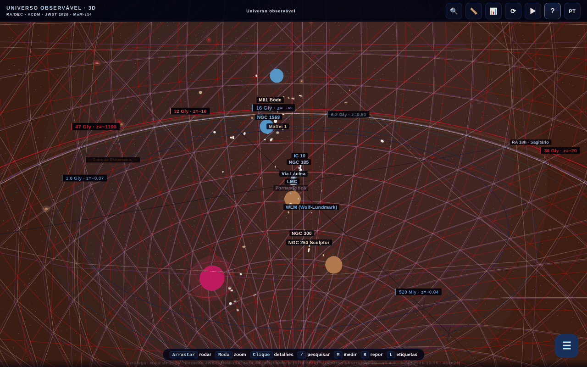

# Universul Observabil 3D

[English](README.md) · [Română](README.ro.md) · [Français](README.fr.md) · [Italiano](README.it.md) · [Español](README.es.md) · **Português** · [Deutsch](README.de.md) · [Magyar](README.hu.md)

**Versão:** 1.4.2 · **Última atualização:** 2026-10-19

Idiomas da interface: **Română, English, Français, Italiano, Español, Português (PT), Deutsch, Magyar**

**Online / demo:** https://chiuta.github.io/Universul-Observabil-3D/

Mapa 3D interativo do universo observável, num único ficheiro HTML (WebGL / three.js): mais de 115 galáxias (118 no catálogo estático), 12 horizontes cósmicos, cursor de tempo, visitas guiadas, pesquisa, medição de distâncias, questionário, exportação glTF/CSV e BibTeX. Interface em 8 idiomas.

**Idiomas:** o guia completo (11 separadores), as 30 visitas guiadas (cerca de 200 passos), os 17 «Sabias que?», a introdução, as descrições das 118 galáxias e dos 13 horizontes/BAO, os nomes de dezenas de objetos, a janela do paradoxo de 45,6 Gal e o glossário contextual (10 termos) estão disponíveis nos 8 idiomas. Permanecem inalterados: os nomes próprios (p. ex. M81 Bode, Maffei), a etiqueta bilingue «Limbă / Language», o conteúdo gerado e as importações CSV. As traduções são automáticas; recomenda-se revisão nativa (sobretudo HU/PT/DE). A fonte romena contém algumas afirmações discutíveis, traduzidas fielmente sem alterações de fundo.

- `index.html` — a aplicação 3D interativa;
- `catalog.html` — versão estática, sem JavaScript, do catálogo (acessibilidade e SEO). Neste idioma: [`catalog.pt.html`](catalog.pt.html).

## Sobre os dados
As posições, distâncias e massas são valores **aproximados e simplificados**, calculados no âmbito do ΛCDM (Planck 2018) e reunidos a partir de catálogos públicos (NED, SIMBAD, programas JWST CEERS/JADES/UNCOVER). A escala é logarítmica e tem fins ilustrativos/educativos; não substitui os catálogos originais. Afirmações «perecíveis» (p. ex. «a galáxia conhecida mais distante», MoM-z14, z=14,44; catálogo «atualizado em maio de 2026») podem tornar-se desatualizadas. Os valores cosmológicos (incluindo a constante de Hubble) têm incertezas e tensões em aberto. A lista exata de fontes por galáxia não está incluída na aplicação.

### Afirmações de «recorde» e datas
As afirmações do tipo «a galáxia mais distante» são formuladas **à data do catálogo (maio de 2026)** e podem ser ultrapassadas por observações posteriores. Reverificado a 11.10.2026: nas fontes públicas consultadas (STScI/NASA, Wikipédia, imprensa) a MoM-z14 continua a ser a galáxia mais distante confirmada espectroscopicamente; não foi encontrado nenhum recorde novo. Fontes: MoM-z14 (z_spec = 14,44) — Naidu et al., arXiv:2505.11263 (pré-publicação de maio de 2025, publicada no Open Journal of Astrophysics, janeiro de 2026); JADES-GS-z14-0 — Carniani et al. 2024, Nature; EGS-z11-R0 — arXiv:2603.15841 (entrada de março de 2026, não verificada de forma independente pelo autor; o estatuto espectroscópico não foi aqui confirmado). As etiquetas «NOVO»/«RECORDE» nos nomes foram substituídas por datas explícitas («adicionada mar. 2026», «recorde (mai. 2026)»). As fontes por galáxia não estão listadas na íntegra; a bibliografia está em curso de preenchimento.

## Utilização
Abra `index.html` num navegador com WebGL. A tecla `R` repõe a câmara, `/` pesquisa, `?` abre o guia e a visita.

## Dados e privacidade
Verificado por auditoria: sem pedidos de rede no carregamento. Os tipos de letra estão incluídos; o idioma escolhido e os marcadores ficam guardados em `localStorage`. As ligações para o arXiv/sítios externos só se abrem ao clicar. Existe código (desativado, a lista `MIRROR_URLS` está vazia) para comparação de versões entre espelhos, que faria um `fetch` apenas se estivesse configurado. A CSP em `index.html` limita agora `connect-src` a `'self'` (estando vazia a lista `MIRROR_URLS`, o código dos espelhos não pode fazer pedidos externos; se a configurar, alargue `connect-src` com os anfitriões dos espelhos). Os scripts em linha só são permitidos através de um hash `sha256` em `script-src`: **depois de qualquer modificação de um script, recalcule os hashes** no meta CSP, caso contrário o script modificado não é executado.

## Limitações
- No iOS, os gestos de pinça iniciados **sobre a tela** estão reservados à câmara 3D; nos painéis e textos, o zoom nativo do sistema continua disponível (ronda 3).
- As citações BibTeX da aplicação (botão «Citar esta aplicação» e `catalog.html`) não têm campo DOI: a aplicação ainda não tem um DOI Zenodo; o campo falso foi removido (ronda 2).

## Licença
MIT, conforme o cabeçalho dos ficheiros; veja `LICENSE`. A página também inclui menções à ASFAN-România.

## Direitos e atribuição
A aplicação e o código pertencem ao autor (licença MIT, veja `LICENSE`). Os dados astronómicos provêm de publicações e catálogos públicos (NED, SIMBAD, arXiv, Planck 2018); os direitos sobre materiais de terceiros pertencem aos respetivos titulares, e a licença MIT não os abrange. Se é titular de direitos ou uma pessoa mencionada e deseja a correção ou a retirada, escreva para alexio@trom.tf; respondemos em 7 dias.

Auditoria: 2026-10-10; ronda 2: 2026-10-11 (removido o DOI de substituição das citações, `connect-src 'self'`).
Ronda 3: 2026-10-11 (formulações «à data do catálogo», fontes para os recordes, gestos iOS limitados à tela).

## Fontes verificadas a 11.10.2026
- O recorde de distância MoM-z14: https://www.stsci.edu/contents/news-releases/2026/news-2026-107 (comunicado de 28 de janeiro de 2026), https://en.wikipedia.org/wiki/MoM-z14 e https://en.wikipedia.org/wiki/List_of_the_most_distant_astronomical_objects — não foi encontrado nenhum recorde espectroscópico mais distante. Os dados do catálogo continuam a ser os de maio de 2026 (EGS-z11-R0 continua por verificar de forma independente).

## Histórico / Changelog

- **1.4.2 — 2026-10-19:** traduzidos 20 nomes de objetos nas etiquetas 3D, no painel e na pesquisa; janela do paradoxo de 45,6 Gal totalmente traduzida; o glossário contextual funciona agora em todos os idiomas (10 termos × 7 idiomas, reaplicado ao mudar de idioma); corrigido «💡 SABIAS QUE» que ficara em romeno em fr, além do aria-label do canvas e do botão «‹ Voltar».
- **1.4.1 — 2026-10-19:** o guia completo (11 separadores), as 30 visitas, os «Sabias que?», a introdução e as descrições de galáxias/horizontes estão traduzidos para en, fr, it, es, pt, de, hu; o guia/visita é reapresentado ao mudar de idioma.
- 1.3.0 — 2026-10-14: Cópia de reserva e rotulagem de dados (fff-kit).
- **1.2.4 — 12 de outubro de 2026:** a versão e a data da última atualização são mostradas na aplicação (caixa de diálogo Guia).
- **1.2.3 — 11 de outubro de 2026:** a tecla `/` (ou Ctrl/Cmd+K) move imediatamente o foco para o campo de pesquisa, pelo que o que se escreve já não se perde nem quando a renderização 3D é lenta; em ecrãs estreitos (≤700 px) o guia de boas-vindas já não se abre automaticamente sobre a cena, mas o botão «?» pulsa até lhe tocar; 0 erros, axe 0 violações a 1280×800 e 360×740.
- **1.2.2 — 11 de outubro de 2026:** CSP com hash `sha256` para os quatro scripts em linha (sem `'unsafe-inline'` e sem `blob:` em `script-src`); ligação «Catálogo de texto acessível (sem JavaScript)» para `catalog.html`, primeiro elemento focável da página (visível ao receber o foco, RO/EN) e na mensagem `noscript`, como alternativa textual à cena WebGL para leitores de ecrã e teclado; versão 1.2.2 (aplicação, `catalog.html`, citação BibTeX).
- **1.2.1 — 11 de outubro de 2026:** no campo de pesquisa funcionam agora ↑/↓/Enter/Esc (antes o manipulador global ignorava os eventos de INPUT); as etiquetas 3D sobrepostas ocultam-se automaticamente por prioridade (horizontes, depois galáxias por ordem de distância) em vez de se misturarem; a visita de boas-vindas é marcada como vista na primeira abertura, pelo que já não volta a abrir-se em cada carregamento se tiver sido fechada com ✕/Esc.
- Acessibilidade/limpeza: pontos de referência `main` / `complementary` (axe-core: 0 violações a 1280×800 e 360×740), `catalog.html`: as tabelas deslocam-se horizontalmente em ecrãs estreitos (sem transbordo da página a 360 px); manipulador `onclick` em linha removido (o botão «Exportar CSV» da tabela de citações), data de compilação 2026-10-11 na aplicação, `catalog.html` e metas, número de versão atualizado em todo o lado.
