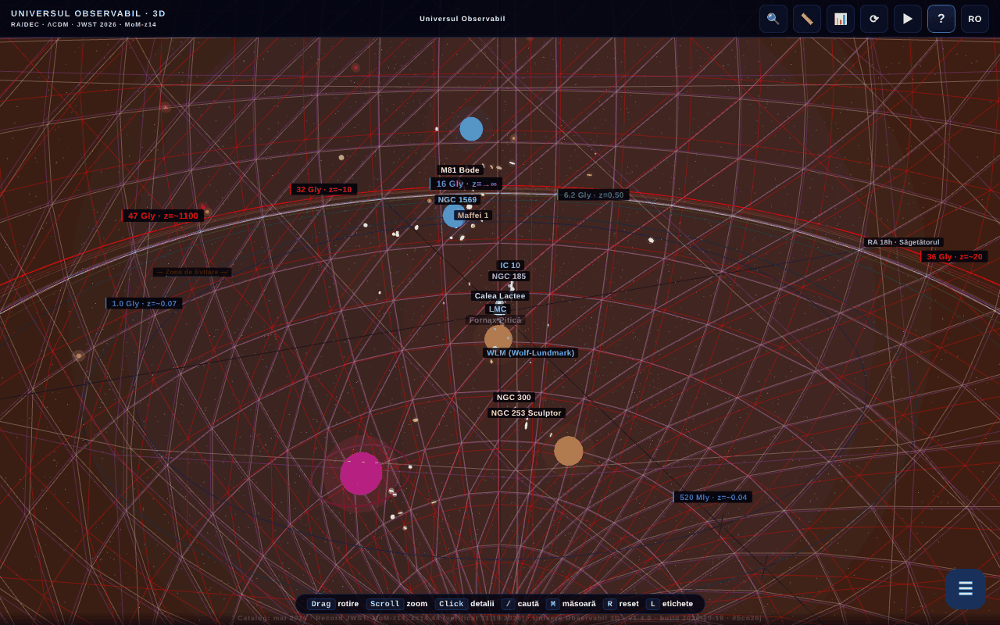

# Universul Observabil 3D

[English](README.md) · **Română** · [Français](README.fr.md) · [Italiano](README.it.md) · [Español](README.es.md) · [Português](README.pt.md) · [Deutsch](README.de.md) · [Magyar](README.hu.md)

**Versiune:** 1.4.5 · **Ultima actualizare:** 2026-10-22

Limbile interfeței: **Română, English, Français, Italiano, Español, Português (PT), Deutsch, Magyar**

**Live / demo:** https://chiuta.github.io/Universul-Observabil-3D/

Hartă 3D interactivă a universului observabil, într-un singur fișier HTML (WebGL / three.js): peste 115 galaxii (118 în catalogul static), 12 orizonturi cosmice, slider de timp, tururi ghidate, căutare, măsurare de distanțe, quiz, export glTF/CSV și BibTeX. Interfață în 8 limbi.

**Limbi:** ghidul complet (11 file), cele 30 de tururi ghidate (circa 200 de pași), cele 17 „Știai că?”, onboarding-ul, descrierile celor 118 galaxii și ale celor 13 orizonturi/BAO, numele a zeci de obiecte, fereastra paradoxului 45,6 Gly și glosarul contextual (10 termeni) sunt disponibile în cele 8 limbi. Rămân neschimbate: numele proprii (de ex. M81 Bode, Maffei), eticheta bilingvă „Limbă / Language”, conținutul generat și importurile CSV. Traducerile sunt automate; se recomandă revizie nativă (mai ales HU/PT/DE). Sursa românească conține câteva afirmații discutabile, traduse fidel, fără modificări de fond.

- `index.html` — aplicația interactivă 3D;
- [`catalog.html`](catalog.html) — versiune statică, fără JavaScript, a catalogului (accesibilitate și SEO).

## Despre date
Poziții, distanțe și mase sunt valori **aproximative și simplificate**, calculate în cadrul ΛCDM (Planck 2018) și grupate din cataloage publice (NED, SIMBAD, programele JWST CEERS/JADES/UNCOVER). Scara este logaritmică și are scop ilustrativ/educațional; nu înlocuiește cataloagele originale. Afirmații „perisabile” (de ex. „cea mai îndepărtată galaxie cunoscută”, MoM-z14, z=14,44; catalog „actualizat în mai 2026”) pot deveni depășite. Valorile cosmologice (inclusiv constanta Hubble) au incertitudini și tensiuni deschise. Lista exactă a surselor per galaxie nu este inclusă în aplicație.

### Afirmații „record” și date
Afirmațiile de tip „cea mai îndepărtată galaxie” sunt formulate **la data catalogului (mai 2026)** și pot fi depășite de observații ulterioare. Reverificat la 11.10.2026: în sursele publice consultate (STScI/NASA, Wikipedia, presă) MoM-z14 rămâne cea mai îndepărtată galaxie confirmată spectroscopic; nu a fost găsit un record nou. Surse: MoM-z14 (z_spec = 14,44) — Naidu et al., arXiv:2505.11263 (preprint mai 2025, publicat în Open Journal of Astrophysics, ianuarie 2026); JADES-GS-z14-0 — Carniani et al. 2024, Nature; EGS-z11-R0 — arXiv:2603.15841 (intrare din martie 2026, neverificată independent de autor; statutul spectroscopic nu a fost confirmat aici). Etichetele „NOU”/„RECORD” din nume au fost înlocuite cu date explicite („adăugat mar. 2026”, „record (mai 2026)”). Sursele per galaxie nu sunt listate integral; bibliografie în curs de completare.

## Utilizare
Deschide `index.html` într-un browser cu WebGL. Tasta `R` resetează camera, `/` caută, `?` deschide ghidul și turul.

## Date și confidențialitate
Verificat prin audit: fără cereri de rețea la încărcare. Fonturile sunt incluse; limba aleasă și semnele de carte se păstrează în `localStorage`. Linkurile către arXiv/site-uri externe se deschid doar la click. Există cod (dezactivat, lista `MIRROR_URLS` este goală) pentru comparație de versiuni între oglinzi, care ar face `fetch` doar dacă este configurat. CSP-ul din `index.html` limitează acum `connect-src` la `'self'` (fiind goală lista `MIRROR_URLS`, codul de oglinzi nu poate face cereri externe; dacă o configurezi, extinde `connect-src` cu gazdele oglinzilor). Scripturile inline sunt permise doar prin hash `sha256` în `script-src`: **după orice modificare a unui script, recalculează hash-urile** din meta CSP, altfel scriptul modificat nu rulează.

## Limitări
- Pe iOS, gesturile de pinch începute **pe canvas** sunt rezervate camerei 3D; pe panouri și texte, zoom-ul nativ al sistemului rămâne disponibil (rundă 3).
- Citațiile BibTeX ale aplicației (butonul „Citează această aplicație” și `catalog.html`) nu au câmp DOI: aplicația nu are încă un DOI Zenodo; câmpul fals a fost eliminat (rundă 2).

## Licență
MIT, conform antetului din fișiere; vezi `LICENSE`. Pagina poartă și mențiuni ASFAN-România.

## Drepturi și atribuire
Aplicația și codul aparțin autorului (licență MIT, vezi `LICENSE`). Datele astronomice provin din publicații și cataloage publice (NED, SIMBAD, arXiv, Planck 2018); drepturile asupra materialelor terțe aparțin titularilor, iar licența MIT nu le acoperă. Dacă ești titular de drepturi sau persoană menționată și dorești corectarea sau retragerea, scrie la alexio@trom.tf; răspundem în 7 zile.

Audit: 2026-10-10; rundă 2: 2026-10-11 (eliminat DOI-ul placeholder din citații, `connect-src 'self'`).
Rundă 3: 2026-10-11 (formulări „la data catalogului”, surse pentru recorduri, gesturi iOS limitate la canvas).

## Surse verificate la 11.10.2026
- Recordul de distanță MoM-z14: https://www.stsci.edu/contents/news-releases/2026/news-2026-107 (comunicat din 28 ianuarie 2026), https://en.wikipedia.org/wiki/MoM-z14 și https://en.wikipedia.org/wiki/List_of_the_most_distant_astronomical_objects — niciun record spectroscopic mai îndepărtat găsit. Datele catalogului rămân cele din mai 2026 (EGS-z11-R0 rămâne neverificat independent).

## Istoric / Changelog

- **1.4.5 — 2026-10-22:** abrevierea „unit.” din afișajul distanței proprii al widgetului grilei comobile urmează acum limba interfeței.
- **1.4.4 — 2026-10-22:** toate etichetele butoanelor din ghidul de intro și reperele din glisorul de distanță („Resetează camera”, „Zboară până la Andromeda”, „Spre CMB”…) sunt traduse în toate cele 8 limbi.
- **1.4.3 — 2026-10-22:** titlul paginii și meta-descrierile urmează limba interfeței; indiciul „R reset” este localizat în română („resetare”).
- **1.4.2 — 2026-10-19:** traduse 20 de nume de obiecte din etichetele 3D, panou și căutare; fereastra paradoxului 45,6 Gly tradusă integral; glosarul contextual funcționează acum în toate limbile (10 termeni × 7 limbi, reaplicat la schimbarea limbii); corectat „💡 ȘTIAI CĂ” rămas în română în fr, plus aria-label-ul canvasului și butonul „‹ Înapoi”.
- **1.4.1 — 2026-10-19:** ghidul complet (11 file), cele 30 de tururi, „Știai că?”, onboarding-ul și descrierile galaxiilor/orizonturilor sunt traduse în en, fr, it, es, pt, de, hu; ghidul/turul se reafișează la schimbarea limbii.
- 1.3.0 — 2026-10-14: Copie de rezervă și etichetare date (fff-kit).
- **1.2.4 — 12 octombrie 2026:** versiunea și data ultimei actualizări sunt afișate în aplicație (dialogul Ghid).
- **1.2.3 — 11 octombrie 2026:** tasta `/` (sau Ctrl/Cmd+K) mută focusul imediat în câmpul de căutare, deci tastarea nu se mai pierde nici când randarea 3D este lentă; pe ecrane înguste (≤700 px) ghidul de bun venit nu se mai deschide automat peste scenă, ci butonul „?” pulsează până îl atingi; 0 erori, axe 0 violări la 1280×800 și 360×740.
- **1.2.2 — 11 octombrie 2026:** CSP cu hash `sha256` pentru cele patru scripturi inline (fără `'unsafe-inline'` și fără `blob:` la `script-src`); link „Catalog text accesibil (fără JavaScript)” către `catalog.html`, primul element focalizabil din pagină (vizibil la focus, RO/EN) și în mesajul `noscript`, ca alternativă textuală la scena WebGL pentru cititoare de ecran și tastatură; versiunea 1.2.2 (aplicație, `catalog.html`, citare BibTeX).
- **1.2.1 — 11 octombrie 2026:** în câmpul de căutare funcționează acum ↑/↓/Enter/Esc (înainte handlerul global ignora evenimentele din INPUT); etichetele 3D care se suprapun se ascund automat după prioritate (orizonturi, apoi galaxii în ordinea distanței) în loc să se amestece; turul de bun venit se marchează ca văzut la prima deschidere, deci nu se mai redeschide la fiecare încărcare dacă a fost închis cu ✕/Esc.
- Accesibilitate/curățenie: repere `main` / `complementary` (axe-core: 0 violări la 1280×800 și 360×740), `catalog.html`: tabelele se derulează orizontal pe ecrane înguste (fără depășire a paginii la 360 px); handler inline `onclick` eliminat (butonul „Exportă CSV” din tabelul de citații), data build 2026-10-11 în aplicație, `catalog.html` și meta-uri, numărul de versiune actualizat peste tot.
